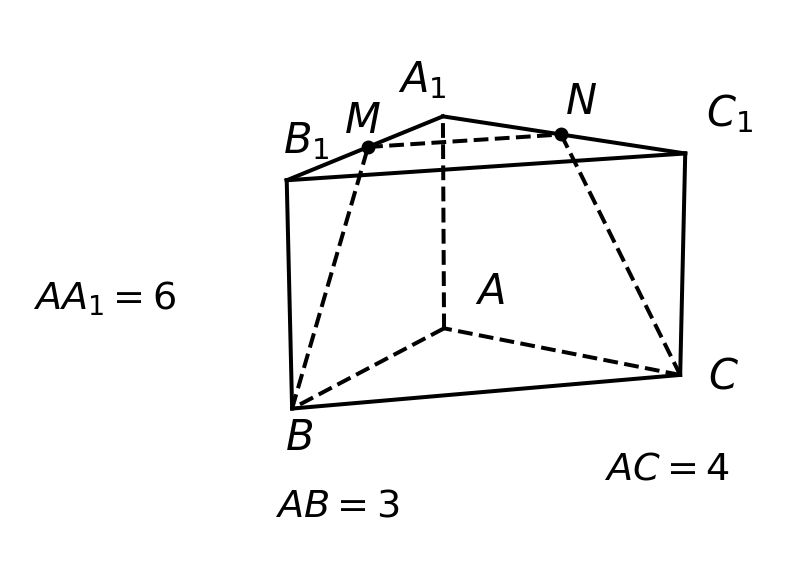
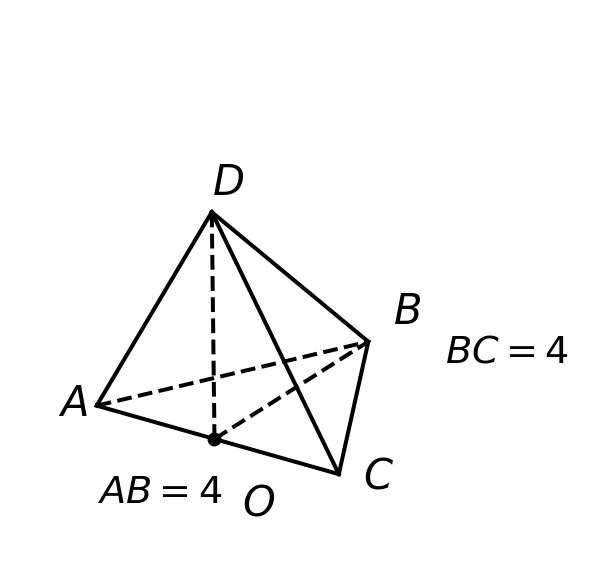
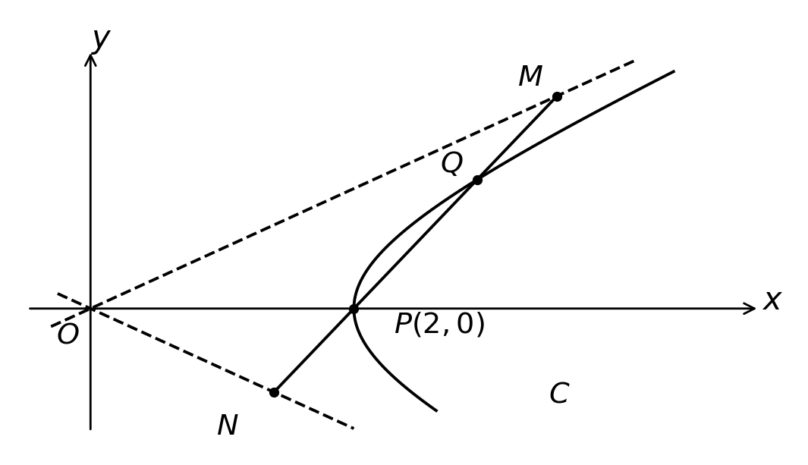

# 2027年河南新高考模拟试卷　数学

满分150分，考试时间120分钟。

本试卷共19题。请在答题卡相应位置作答。

## 一、单项选择题

本大题共8小题，每小题5分，共40分。在每小题给出的四个选项中，只有一项是符合题目要求的。

## 1.（5分）

复数 \(z\) 满足 \((2+\mathrm i)z=1-3\mathrm i\)，则 \(z+2\overline z=\)
A．\(\frac{-3+7\mathrm i}{5}\)
B．\(\frac{-3-7\mathrm i}{5}\)
C．\(\frac{-1+21\mathrm i}{5}\)
D．\(\frac{7+3\mathrm i}{5}\)

## 2.（5分）

设 \(A=\{x\mid |x-2|<3\}\)，\(B=[a,2a+1]\)。若 \(B\ne\varnothing\) 且 \(B\subseteq A\)，则 \(a\) 的取值范围是
A．\([-1,2)\)
B．\((-1,2)\)
C．\((-1,2]\)
D．\([-1,2]\)

## 3.（5分）

已知平面向量 \(\boldsymbol a,\boldsymbol b\) 满足 \(|\boldsymbol a|=2\)，\(|\boldsymbol b|=3\)，\(|\boldsymbol a+\boldsymbol b|=\sqrt{19}\)。向量 \(2\boldsymbol b-\boldsymbol a\) 在 \(\boldsymbol a\) 方向上的数量投影为
A．\(-1\)
B．\(\frac12\)
C．\(1\)
D．\(2\)

## 4.（5分）

随机变量 \(X\) 服从正态分布 \(N(10,\sigma^2)\)。记 \(p=P(8<X<11)\)，\(q=P(11<X<12)\)，则 \(P(X<9)=\)
A．\(\frac{1-p-q}{2}\)
B．\(\frac{1-p+q}{2}\)
C．\(\frac{1+p-q}{2}\)
D．\(\frac{1-p+2q}{2}\)

## 5.（5分）

若 \(\frac{\pi}{2}<\alpha<\pi\)，且 \(\sin\alpha+\cos\alpha=\frac{\sqrt5}{5}\)，则 \(\sin(2\alpha+\frac{\pi}{4})=\)
A．\(-\frac{7\sqrt2}{10}\)
B．\(-\frac{\sqrt2}{10}\)
C．\(\frac{\sqrt2}{10}\)
D．\(\frac{7\sqrt2}{10}\)

## 6.（5分）

斜率为 \(k\) 的直线经过抛物线 \(y^2=4x\) 的焦点，并与抛物线交于 \(M,N\) 两点。若 \(|MN|=8\)，则 \(|k|=\)
A．\(\frac12\)
B．\(1\)
C．\(\sqrt2\)
D．\(2\)

## 7.（5分）

如图，三棱柱 \(ABC-A_1B_1C_1\) 的侧棱垂直于底面，\(AB\perp AC\)，\(AB=3\)，\(AC=4\)，\(AA_1=6\)。设 \(M,N\) 分别为 \(A_1B_1,A_1C_1\) 的中点，则平面 \(BCM\) 截该三棱柱所得截面的面积为

A．\(\frac{45}{2}\)
B．\(\frac{3\sqrt{26}}2\)
C．\(\frac{9\sqrt{26}}2\)
D．\(\frac{9\sqrt{29}}2\)

## 8.（5分）

设 \(f(x)=x^3-3x\)。若方程 \(f(f(x)-1)=m\) 恰有三个不同的实数解，则 \(m\) 的取值范围是
A．\([-18,-2)\)
B．\((-18,-2]\)
C．\((-2,2)\)
D．\((-18,-2)\)

## 二、多项选择题

本大题共3小题，每小题6分，共18分。在每小题给出的四个选项中，有多项符合题目要求。全部选对的得6分，部分选对的得部分分，有选错的得0分。

## 9.（6分）

甲盒中有3个红球和2个蓝球，乙盒中有1个红球和4个蓝球。等可能地选中一盒，再从中依次随机取出两球，取出的球不放回。下列说法正确的是
A．已知选中甲盒，两球均为红球的概率为 \(\frac3{10}\)
B．两球均为红球的概率为 \(\frac3{10}\)
C．已知两球恰有一个红球，选中甲盒的概率为 \(\frac35\)
D．已知第一球为红球，第二球为红球的概率为 \(\frac25\)

## 10.（6分）

已知 \(g(x)=\sin 2x+\sin 4x\)。下列说法正确的是
A．\(g(x)\) 的最小正周期是 \(\pi\)
B．点 \((\frac{\pi}{2},0)\) 是 \(g(x)\) 图象的一个对称中心
C．当 \(0<x<\frac{\pi}{2}\) 时，恒有 \(g(x)>0\)
D．\(g(x)\) 在 \((0,\frac{\pi}{2})\) 内恰有两个极值点

## 11.（6分）

数列 \(\{a_n\}\) 满足 \(a_1=1\)，\(a_{n+1}=2a_n+(-1)^n\)。设 \(S_n\) 为其前 \(n\) 项和。下列说法正确的是
A．数列 \(\{a_n\}\) 严格递增
B．数列 \(\{a_n+\frac13(-1)^n\}\) 是公比为2的等比数列
C．对任意正整数 \(m\)，\(S_{2m}=\frac{4^m-1}{3}\)
D．对任意正整数 \(n\)，\(a_{n+2}-a_n=2^n\)

## 三、填空题

本大题共3小题，共15分。请将答案填在横线上。

## 12.（5分）

多项式 \((x+2)^5(1-x)^2\) 展开后，\(x^2\) 的系数为 ________。

## 13.（5分）

若实数 \(x,y\) 满足 \(x^2+y^2=4\)，则 \(\frac{x+2y}{3+x-y}\) 的最大值为 ________。

## 14.（5分）

将6个甲字和6个乙字排成一行，记 \(d_k\) 为从左向右前 \(k\) 个字中甲字与乙字的个数之差（甲数减乙数）。考虑满足以下条件的排列：对 \(k=1,2,\ldots,12\)，均有 \(d_k\ge0\)；在 \(d_1,d_2,\ldots,d_{11}\) 中恰有两个等于0、恰有一个等于3。对每种这样的排列，把使 \(d_k=3\) 的唯一位置记为 \(k_0\)。所有这样排列的 \(k_0\) 之和为 ________。

## 四、解答题

本大题共5小题，共77分。解答应写出文字说明、证明过程或演算步骤。

## 15.（13分）

在 \(\triangle ABC\) 中，内角 \(A,B,C\) 所对的边分别是 \(a,b,c\)，且 \(\sin 2B+\sin 2C=\sin 2A\)。
（1） 证明：该三角形是直角三角形。
（2） 若 \(b<c\) 且三角形的周长为 \(24\)，求其面积的最大值。

## 16.（15分）

如图，将边长为 \(4\) 的正方形 \(ABCD\) 沿对角线 \(AC\) 折起，使平面 \(ABC\) 与平面 \(ACD\) 垂直。记 \(AC\) 的中点为 \(O\)。

（1） 证明 \(AC\perp BD\)，并求 \(|BD|\)。
（2） 点 \(X,Y\) 分别在棱 \(AB,CD\) 上移动（含端点）。求 \(|XY|\) 的最小值，并求取到最小值时 \(|AX|/|AB|\) 和 \(|CY|/|CD|\)。

## 17.（15分）

某试验将80个面积相同的地块等分为甲、乙两组，两组采用不同灌溉方式。达标情况如下：甲组达标28个、不达标12个，乙组达标18个、不达标22个。设 \(2\times2\) 列联表的第一、二行依次为 \((a,b),(c,d)\)，采用统计量 \(\chi^2=\frac{80(ad-bc)^2}{(a+b)(c+d)(a+c)(b+d)}\)。本题的判定规则为：若 \(\chi^2\ge3.841\)，就认为有证据表明灌溉方式与是否达标有关；否则认为证据不足。
（1） 根据这份列联表，给出判定并说明理由。
（2） 复核只允许更正地块的达标状态，不改所属组，每个地块最多更正一次。问至少更正几个地块才能使判定改变，并列出达到这一最少数量时所有可能的更正方式（只区分组别和更正方向）。

## 18.（17分）

如图，\(P(2,0)\) 为双曲线 \(C:x^2-y^2=4\) 的右顶点，点 \(Q\) 在 \(C\) 的右支上且纵坐标大于0。直线 \(PQ\) 与渐近线 \(y=x\)、\(y=-x\) 分别交于 \(M,N\)，记 \(S\) 为 \(\triangle OMN\) 的面积（\(O\) 为坐标原点）。

（1） 证明：线段 \(MN\) 与 \(PQ\) 的中点重合。
（2） 若 \(S=9\)，求点 \(Q\) 的坐标。
（3） 用 \(S\) 表示 \(|MN|^2\)，并求 \(|MN|\) 的取值范围。

## 19.（17分）

设 \(a\ge0\)，函数 \(H_a(x)=\ln(1+x)-\frac{x}{1+ax}\) 的定义域为 \([0,+\infty)\)。
（1） 证明：当 \(t>0\) 时，\(\frac{t^2}{2}<e^t-1-t<\frac{e^t t^2}{2}\)。
（2） 根据导数符号讨论 \(H_a(x)\) 在 \((0,+\infty)\) 上的单调性，并求其正零点的个数。
（3） 若 \(0<a<\frac12\)，记 \(H_a(x)\) 的正零点为 \(x_a\)。求实数 \(\lambda\) 的取值范围，使得对所有这样的 \(a\)，都有 \(\ln(1+x_a)>\frac1a-\lambda\)。
