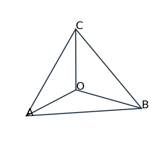
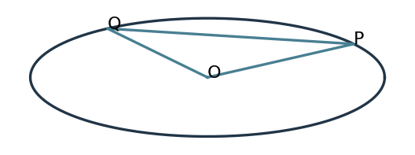

# 河南2027高考风格数学模拟 · 150分

## 1.（5分）

复数z满足z+共轭z=10，且|z-2|²=13。求(Im z)²。

A. \(4\)

B. \(2\)

C. \(13\)

D. \(9\)

## 2.（5分）

集合A={x∈Z|(x-4)(x-12)≤0}，B为3的整数倍的集合。求A中不属于B的元素个数。

A. \(6\)

B. \(5\)

C. \(9\)

D. \(3\)

## 3.（5分）

已知\(t\in(0,\pi/2)\)，且\(\sin t+\cos t=\sqrt{6}/2\)。求\(\sin 2t\)。

A. \(\frac{3}{4}\)

B. \(\frac{1}{2}\)

C. \(\frac{\sqrt{6}}{4}\)

D. \(- \frac{1}{2}\)

## 4.（5分）

向量u=(2,1)，v=(1,t)，且u⊥v。求|u+v|²。

A. \(18\)

B. \(2\)

C. \(10\)

D. \(5\)

## 5.（5分）

椭圆\(\frac{x^{2}}{81} + \frac{y^{2}}{16}\)=1被直线y=2截得的弦长是多少？

A. \(4 \sqrt{3}\)

B. \(18\)

C. \(\frac{9 \sqrt{3}}{2}\)

D. \(9 \sqrt{3}\)

## 6.（5分）

袋中有3个红球、4个蓝球，各球等可能取到。无放回连续取2球，求恰好一红一蓝的概率。

A. \(\frac{3}{7}\)

B. \(\frac{2}{7}\)

C. \(\frac{4}{7}\)

D. \(\frac{24}{49}\)

## 7.（5分）

关于x的方程x²-2tx+t=0有两个互异正实根。t的取值范围的有限端点是多少？

A. \(-1\)

B. \(0\)

C. \(1\)

D. \(\frac{1}{2}\)

## 8.（5分）

方程\(\sin(2x)=1/2\)在\(0<x<2\pi\)内有多少个解？

A. \(8\)

B. \(2\)

C. \(4\)

D. \(3\)

## 9.（6分）

数列满足a₁=2，a₂=4，且对每个正整数n有aₙ₊₂=aₙ+2。求前8项的和。 判断下列命题，选择所有正确选项。

A. 题中所求和为\(48\)

B. 奇数项构成公比为2的等比数列

C. 偶数项构成公差为2的等差数列

D. 整个数列一定是等差数列

## 10.（6分）

空间取O=(0,0,0)，A=(2,0,0)，B=(0,2,0)，C=(0,0,4)，M为AB中点。 判断下列命题，选择所有正确选项。

A. OA垂直平面OBC

B. CM平行AB

C. CM垂直AB

D. OA平行CM

## 11.（6分）

设f(x)=ln x-(4/2)x²（x>0）。 判断下列命题，选择所有正确选项。

A. f在\(\frac{1}{2}\)处取得最大值

B. 最大值为\(- \frac{\log{\left(4 \right)}}{2} - \frac{1}{2}\)

C. f′在定义域内严格递减

D. f在定义域内的最小值可以取到

## 12.（5分）

求\(\left(x + \frac{1}{x}\right)^{4}\)展开式中x²的系数。

## 13.（5分）

某组数据X的均值为2，方差为3。每个数据改为Y=4X-2，求新数据的方差。

## 14.（5分）

求函数\(x e^{- \frac{x}{2}}\)（x∈R）的最大值。

## 15.（13分）

先等可能选甲、乙之一，再从选中的袋中有放回抽两次。甲袋红球概率1/3，乙袋红球概率2/3。记两次红球指示量为I₁,I₂。(1)求首次红球的概率；(2)已知首次红球，求选中乙袋的概率；(3)求两次均红概率，判断I₁,I₂是否独立并求其协方差。

## 16.（15分）

O=(0,0,0)，A=(5,0,0)，B=(0,5,0)，C=(0,0,h)，h>0。M,N分别为AC,BC中点。(1)证明MN∥AB；(2)用h表示O到平面ABC距离；(3)若直线OC与平面ABC夹角的正弦为1/√3，求h及上述距离。

## 17.（15分）

数列满足a₁=5，aₙ₊₁=4aₙ+(5)(-1)ⁿ。求通项aₙ及前6项和。

## 18.（17分）

椭圆\(\frac{x^{2}}{36} + \frac{y^{2}}{4}\)=1上取P=(6cos t,2sin t)，Q=(-6sin t,2cos t)，t∈R，O为原点。(1)证明△OPQ面积不变并求其值；(2)求PQ长度范围；(3)求中点M轨迹的方程并说明是否取遍。

## 19.（17分）

设F(x)=(ln x)³-3ln x-c（x>0）。(1)求F(x)=0有三个互异正根的c的范围；(2)记三根x₁<x₂<x₃，证明乘积为1；(3)若x₁x₃=x₂²，求c和三根。

