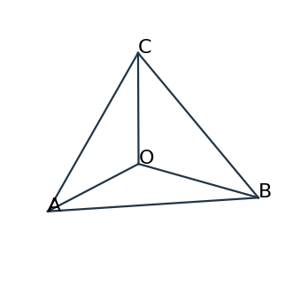

# 数学综合检测 · 50分

## 1.（5分）

复数z满足z+共轭z=8，且|z-3|²=8。求(Im z)²。

A. \(8\)

B. \(9\)

C. \(7\)

D. \(6\)

## 2.（5分）

集合A={x∈Z|(x-4)(x-10)≤0}，B为4的整数倍的集合。求A中不属于B的元素个数。

A. \(4\)

B. \(5\)

C. \(6\)

D. \(7\)

## 3.（5分）

向量u=(4,1)，v=(1,t)，且u⊥v。求|u+v|²。

A. \(35\)

B. \(33\)

C. \(34\)

D. \(36\)

## 4.（5分）

袋中有5个红球、2个蓝球，各球等可能取到。无放回连续取2球，求恰好一红一蓝的概率。

A. \(\frac{52}{21}\)

B. \(\frac{31}{21}\)

C. \(- \frac{11}{21}\)

D. \(\frac{10}{21}\)

## 5.（5分）

求\(\left(x + \frac{1}{x}\right)^{8}\)展开式中x²的系数。

A. \(57\)

B. \(56\)

C. \(58\)

D. \(55\)

## 6.（10分）

O=(0,0,0)，A=(5,0,0)，B=(0,5,0)，C=(0,0,h)，h>0。M,N分别为AC,BC中点。(1)证明MN∥AB；(2)用h表示O到平面ABC距离；(3)若直线OC与平面ABC夹角的正弦为1/√3，求h及上述距离。

## 7.（15分）

设F(x)=(ln x)³-3ln x-c（x>0）。(1)求F(x)=0有三个互异正根的c的范围；(2)记三根x₁<x₂<x₃，证明乘积为1；(3)若x₁x₃=x₂²，求c和三根。

