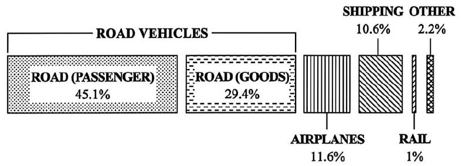

# 新高考英语阅读真题练习

满分7.5分　考试时间12分钟

## 练习题

## 2025 年原卷材料 · 原题 21

The greening of planes, trains and automobiles Moving goods and people around the world is responsible for a large part of global CO2 emissions (排放). As the world races to decarbonize everything, it faces particular problems with transportation — which accounts for about a quarter of our energy-related greenhouse gas emissions. Here’s the breakdown of the emissions in 2018 for different modes of transport.

[Chart: Road passengers 45.1%; road goods 29.4%; airplanes 11.6%; shipping 10.6%; rail 1%; other 2.2%.]

The fuels for transport need to be not just green, cheap and powerful, but also lightweight and safe enough to be carried around. Each mode of transport has its specific fuel needs. Much is still to be settled, but here are some of the solutions to get us going green.

PLANES — Synthetic hydrocarbons The hardest sector to decarbonize is aviation.

One long-term option for sustainable fuel for planes is to make hydrocarbons from recycled air.

CARS — Batteries Batteries are energy-efficient and electric cars can plug into existing systems and services. New solid-state batteries will take a car farther on a single charge.

TRAINS — Electricity Some trains are already electrified through rails or wires; others can be made electric in pretty simple ways.

TRUCKS — Hydrogen fuel cells Hydrogen fuel cells are a lighter choice than batteries for trucks, but making green hydrogen is expensive.

SHIPS — Liquid ammonia Liquid ammonia is easy to keep and transport, but it is hard to ignite (点燃) and requires an engine redesign.

This energy transition (变革) is global, and the amount of renewable energy the world will need is “a little bit mind-blowing,” says mechanical engineer Keith Wipke at the National Renewable Energy Laboratory. It’s estimated that the global demand for electricity could more than double by 2050. Fortunately, analyses suggest that renewables are up to the task. “We need to speed up the development of green energy, and it will all get used,” says Wipke.

### 1.（2.5分）What percentage of global transport emissions did road vehicles account for in 2018?

A. 11.6%.　　B. 45.1%.

C. 74.5%.　　D. 86.1%.

### 2.（2.5分）Which mode of transport can go green comparatively easily?

A. Planes.　　B. Trucks.

C. Trains.　　D. Ships.

### 3.（2.5分）What does Wipke suggest regarding energy transition?

A. Limiting fuel consumption.　　B. Putting more effort into renewables.

C. Improving energy efficiency.　　D. Making electricity more affordable.
