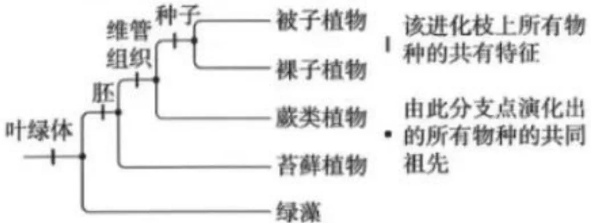
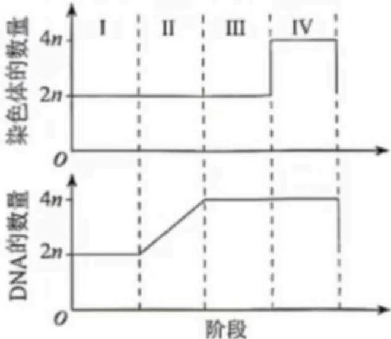

# 河南生物学真题练习

## 1.（3分）

系统进化树是一种表示物种间亲缘关系的树形图。研究人员结合形态学和分子证据,构建了绿色植物的系统进化关系,示意简图如下。下列推断正确的是()

A．植物的系统进化关系是共同由来学说的体现和自然选择的结果
B．基因重组增强了生物变异的多样性,但不影响进化的速度和方向
C．绿藻化石首次出现地层的年龄小于苔藓植物化石首次出现地层的年龄
D．裸子植物与被子植物的亲缘关系比裸子植物与蕨类植物的亲缘关系远

## 2.（3分）

M 是细胞周期的关键调节因子, 参与调控染色质凝集、纺锤体组装及核膜破裂。细胞周期中染色体和 DNA 的数量变化如图所示。M 发挥上述作用的阶段是（）

A．I
B．II
C．III
D．IV
