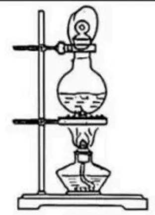
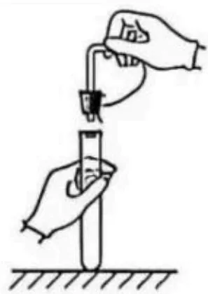
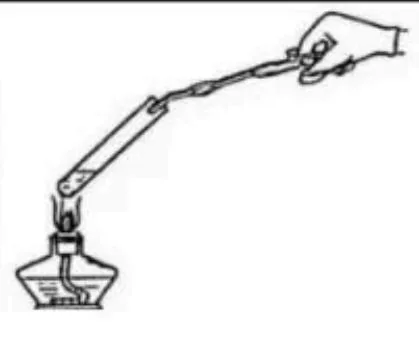
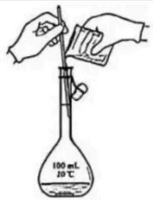

# 河南化学真题练习

## 1.（3分）

对于下列过程中发生的化学反应，相应离子方程式正确的是
A．磷酸二氢钠水解： \(H_{2}PO_{4}^{-}+H_{2}O⇌H_{3}PO_{4}+OH^{-}\)
B．用稀盐酸浸泡氧化银： \(Ag_{2}O+2H^{+}=2Ag^{+}+H_{2}O\)
C．向次氯酸钠溶液中加入碘化氢溶液： \(ClO^{-}+H^{+}=HClO\)
D．向硫酸氢钠溶液中滴加少量碳酸氢钡溶液： \(H^{+}+SO_{4}^{2-}+Ba^{2+}+HCO_{3}^{-}=BaSO_{4}↓+CO_{2}↑+H_{2}O\)

## 2.（3分）

下列图示中，实验操作符合规范的是

A．除去水中氧气
B．连接橡胶塞和试管
C．加热溶液
D．向容量瓶中转移溶液
