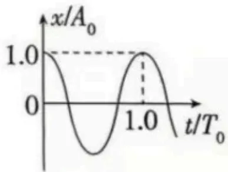
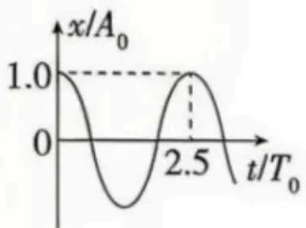
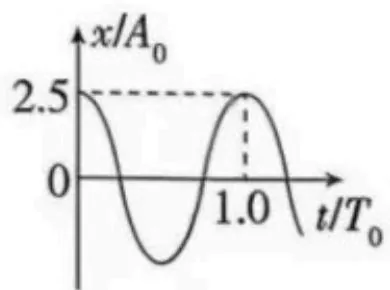
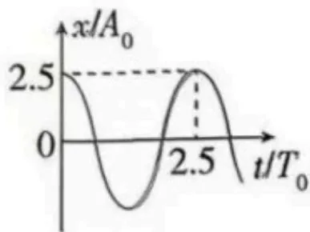
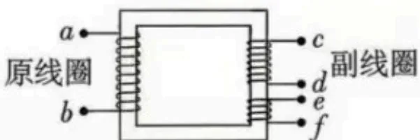

# 河南物理真题练习

## 1.（4分）

将一单摆的摆球拉开一个小角度后释放，单摆摆动的振幅为 \(A_{0}\) ，周期为 \(T_{0}\) 。若将此摆移到月球上，拉开相同的角度，则摆球的振动图像可能正确的是

A．对应选项图
B．对应选项图
C．对应选项图
D．对应选项图

## 2.（4分）

为确定一变压器副线圈 cd 的匝数，某同学在变压器铁芯上缠绕 10 匝线圈 ef，如图所示。 原线圈 ab 接入一正弦交流电源，c、d 两端电压为 10V；若将 d、e 两端连接，ab 接入的电源不变，c、f 两端电压为 11V，变压器视为理想变压器，则副线圈 cd 的匝数为

A．200
B．190
C．110
D．100
