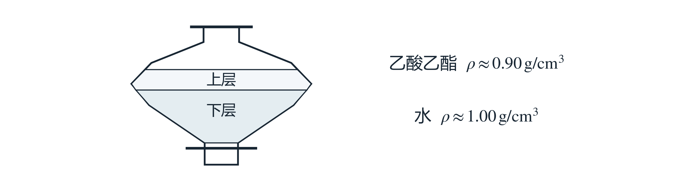
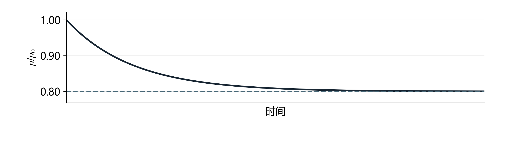
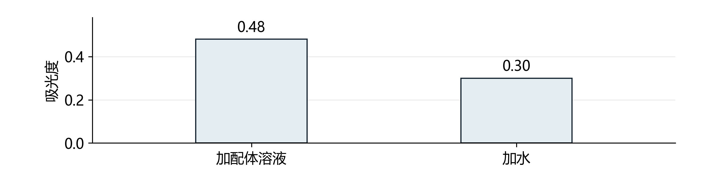
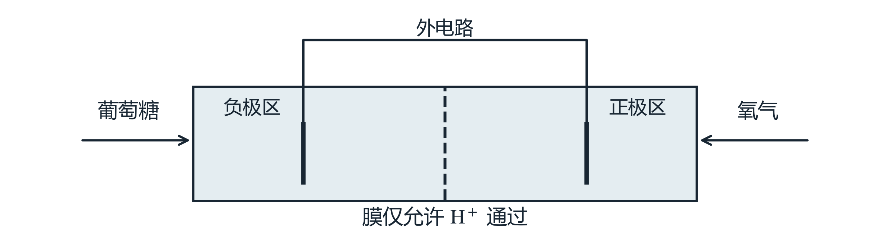
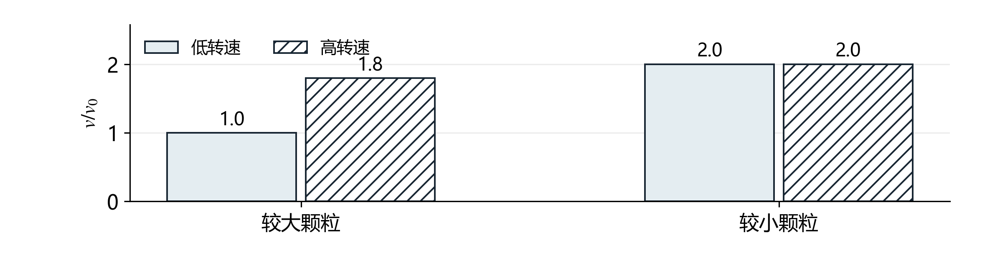
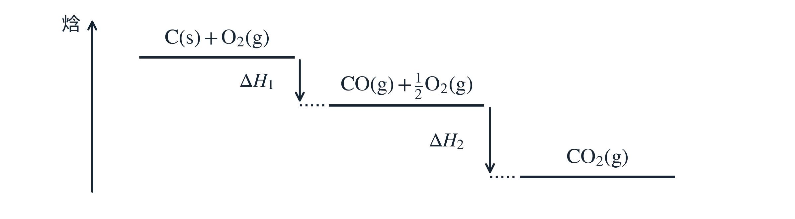
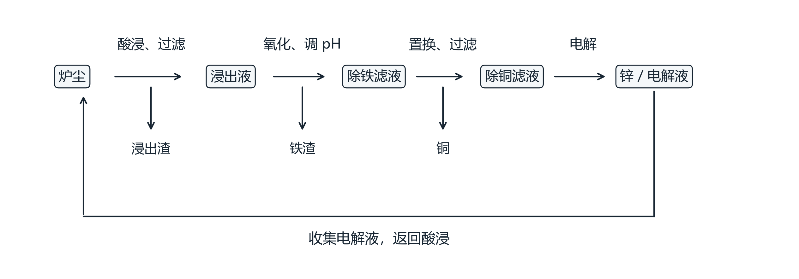
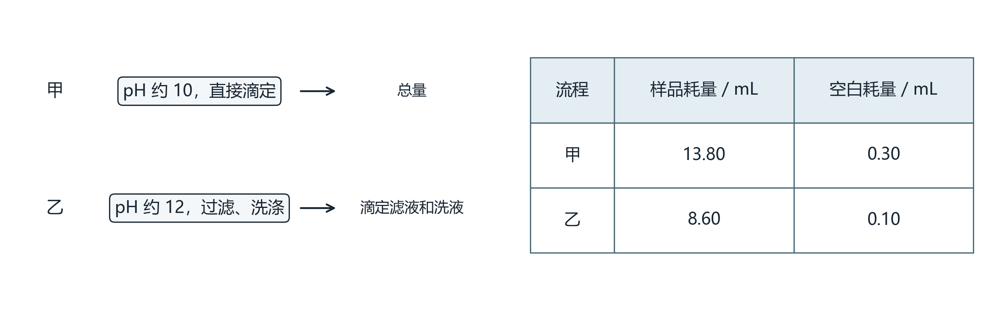
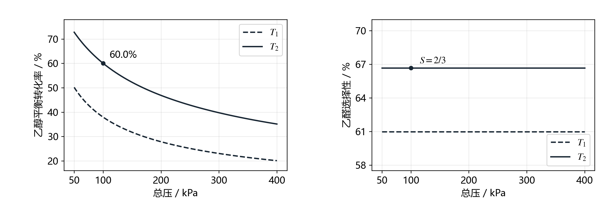
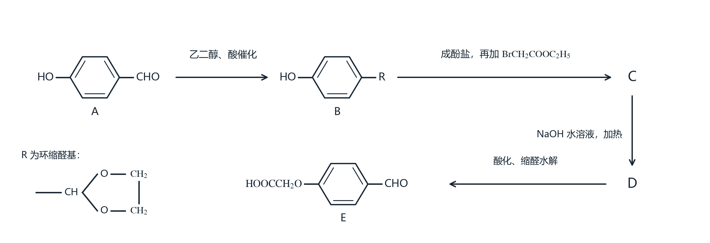

# 河南新高考化学模拟试卷

满分100分，考试时间75分钟。

## 一、单项选择题

本大题共14小题，每小题3分，共42分。在每小题给出的四个选项中，只有一项是符合题目要求的。

## 1.（3分）

将海藻酸钠溶液滴入氯化钙溶液，可制得外形稳定的凝胶小球。已知海藻酸链上有多个羧酸根。下列说法正确的是（　　）
A．氯化钙使海藻酸钠发生了聚合反应
B．形成凝胶的过程中，钙元素发生了还原
C．钙离子可以在不同高分子链的羧酸根之间形成离子交联
D．等物质的量的氯化钠可起到与氯化钙相同的交联作用

## 2.（3分）

相同温度和压强下，两个容器中分别装有等体积的 \({}^{16}\mathrm{O}_2\) 和 \({}^{18}\mathrm{O}_2\)，两种气体均可视为理想气体。下列说法正确的是（　　）
A．两容器中气体的质量相等
B．两容器中所含的氧原子数相等
C．每个 \({}^{18}\mathrm{O}_2\) 分子比每个 \({}^{16}\mathrm{O}_2\) 分子多 2 个中子
D．两种分子所含的电子总数不同

## 3.（3分）

肉桂醇是一种芳香族有机物，其结构见图。下列说法正确的是（　　）

A．肉桂醇只含羟基一种官能团
B．肉桂醇的分子式为 \(\mathrm{C_9H_{12}O}\)
C．肉桂醇分子中所有碳原子一定处于同一平面
D．肉桂醇的碳碳双键可与溴发生加成，羟甲基可被氧化为醛基

## 4.（3分）

下列离子方程式能完整、正确地表示指定条件下的主要反应的是（　　）
A．向碳酸氢钠溶液中加入足量氢氧化钠溶液：\(\mathrm{HCO_3^-+OH^-\rightarrow CO_3^{2-}+H_2O}\)
B．向铜片中加入稀盐酸：\(\mathrm{Cu+2H^+\rightarrow Cu^{2+}+H_2\uparrow}\)
C．向氯化银固体中加入稀硝酸：\(\mathrm{AgCl+H^+\rightarrow Ag^++HCl}\)
D．用过量氢氧化钡溶液与硫酸铵溶液混合并加热：\(\mathrm{Ba^{2+}+SO_4^{2-}\rightarrow BaSO_4\downarrow}\)

## 5.（3分）

图示某立方晶胞中 A、B、X 三种粒子的占位，晶胞按立方格点周期延伸。下列说法正确的是（　　）

A．每个晶胞实际含有 8 个 A 粒子
B．每个 B 粒子最近的 X 粒子共有 6 个
C．晶体中 A、B、X 粒子之比为 \(1:1:6\)
D．体心处的 B 粒子与相邻晶胞共同占有

## 6.（3分）

某组尝试从乙酸、乙醇和乙酸乙酯的混合液中分离乙酸乙酯。图示用饱和碳酸钠溶液洗涤后静置的装置及部分数据。乙酸乙酯微溶于水。下列做法或判断正确的是（　　）

A．加足量水混合后直接蒸干水层，可得到纯乙酸乙酯
B．加饱和碳酸钠溶液洗涤时，分液漏斗内产生的气体应通过适时放气排出
C．洗涤静置后，应取下层液体作为富含乙酸乙酯的组分
D．洗涤时有气泡即可证明混合液中的乙酸已被除尽

## 7.（3分）

向恒温恒容容器中充入 \(0.250\ \mathrm{mol}\) 氮气和 \(0.750\ \mathrm{mol}\) 氢气，只发生合成氨反应。气体均按理想气体处理，图示气体总压 \(p\) 与初始总压 \(p_0\) 的比随时间的变化。下列说法正确的是（　　）

A．平衡时氨的物质的量为 \(0.100\ \mathrm{mol}\)
B．平衡时氮气的转化率为 20%
C．平衡时氨的物质的量分数为 25%
D．平衡时氢气的分压为其初始分压的 80%

## 8.（3分）

第三周期元素 X 的前三个电离能依次约为 738、1451、7733，单位为 \(\mathrm{kJ/mol}\)。下列推断正确的是（　　）
A．X 的最高价氧化物的水化物是强酸
B．X 最易形成只带一个单位正电荷的简单离子
C．X 的基态原子最外层电子排布为 \(3s^23p^1\)
D．X 的基态原子最外层有 2 个电子，常见氧化物中 X 为 \(+2\) 价

## 9.（3分）

恒温下，水溶液中金属 M 仅以 \(\mathrm{M^{2+}}\)、\(\mathrm{ML^+}\) 两种形式存在，并有平衡 \(\mathrm{M^{2+}+L^-\rightleftharpoons ML^+}\)。将同一母液等分，分别加配体溶液和水，使终体积相同，测得吸光度如图。在所测波长只有 \(\mathrm{ML^+}\) 的吸收可观测，吸光度与其浓度成正比。加入的试剂均不含 M，且无沉淀或其他反应。下列说法正确的是（　　）

A．加配体的一份所含的金属 M 总量更大
B．加水的一份配合物浓度更高
C．两份中每摩尔 M 处于配合物形态的比例相同
D．加配体的一份中 M 以 \(\mathrm{ML^+}\) 形式存在的比例更大

## 10.（3分）

一定温度下，将碳酸氢钠溶于水制成稀溶液。溶液与外界不交换物质，无沉淀，溶解的二氧化碳计入 \(\mathrm{H_2CO_3}\)。下列关系一定成立的是（　　）
A．\(c(\mathrm{Na^+})=c(\mathrm{HCO_3^-})\)
B．\(c(\mathrm{H^+})=c(\mathrm{OH^-})\)
C．\(c(\mathrm{H^+})+c(\mathrm{H_2CO_3})=c(\mathrm{OH^-})+c(\mathrm{CO_3^{2-}})\)
D．\(c(\mathrm{HCO_3^-})+c(\mathrm{H_2CO_3})=2c(\mathrm{Na^+})\)

## 11.（3分）

一种以酸性水溶液为电解质的燃料电池如图所示。葡萄糖在一侧完全转化为二氧化碳，氧气在另一侧只被还原为水。下列说法正确的是（　　）

A．放电时质子由正极区经膜移向负极区
B．消耗 \(1.0\ \mathrm{mol}\) 氧气时，负极生成 \(1.0\ \mathrm{mol}\) 二氧化碳
C．放电时电子由负极穿过质子交换膜移向正极
D．每消耗 \(1.0\ \mathrm{mol}\) 葡萄糖，外电路只转移 \(6.0\ \mathrm{mol}\) 电子

## 12.（3分）

相同温度、相同起始浓度下，用等质量、不同粒径的同种固体催化剂催化一个液相反应。反应液体积相同，以不同转速搅拌，所测反应初速如图。下列说法正确的是（　　）

A．较大颗粒的两组实验支持液体传质影响表观初速
B．较小颗粒的两组结果证明搅拌在任意转速下均不改变表观初速
C．较小颗粒能提高反应的平衡常数
D．已可据此确定反应的微观机理

## 13.（3分）

同温同压下，石墨分两步燃烧至二氧化碳的反应焓关系如图。下列说法正确的是（　　）

A．\(\mathrm{C}(s)+\mathrm{CO}_2(g)\rightarrow2\mathrm{CO}(g)\) 的反应焓为 \(\Delta H_2-\Delta H_1\)
B．\(\mathrm{C}(s)+\mathrm{O}_2(g)\rightarrow\mathrm{CO}_2(g)\) 的反应焓为 \(\Delta H_1-\Delta H_2\)
C．\(\mathrm{C}(s)+\mathrm{CO}_2(g)\rightarrow2\mathrm{CO}(g)\) 的反应焓为 \(\Delta H_1-\Delta H_2\)
D．催化剂可同时减小两个燃烧反应的反应焓绝对值

## 14.（3分）

同温下，一元弱酸 HA、HB 的电离常数满足 \(K_{\mathrm a}(\mathrm{HA})=100K_{\mathrm a}(\mathrm{HB})\)。混合等物质的量的 HA 与 NaB，用 \(c_0\) 表示混合后两者各自的分析浓度。在本题浓度范围，只按质子转移 \(\mathrm{HA+B^-\rightleftharpoons A^-+HB}\) 计算各物种的物料变化，忽略游离的 \(\mathrm{H^+}\)、\(\mathrm{OH^-}\) 对物料变化的贡献。达到平衡时，\(c(\mathrm{A^-})/c_0\) 为（　　）
A．\(1/101\)
B．\(10/11\)
C．\(1/11\)
D．\(100/101\)

## 二、非选择题

本大题共4小题，共58分。按题意填写或作答。计算题须写出必要的文字说明、方程式和演算步骤。

## 15.（14分）

某镀锌炉尘含氧化锌、氧化铁、少量金属铁、氧化铜和二氧化硅。用足量稀硫酸浸出，过滤后所得溶液检出锌、二价铁、三价铁和铜的离子。其余步骤如图。 25 ℃时，\(K_{\mathrm{sp}}(\mathrm{Fe(OH)_3})=1.0\times10^{-38}\)，\(K_{\mathrm{sp}}(\mathrm{Zn(OH)_2})=3.0\times10^{-17}\)，水的离子积为 \(1.0\times10^{-14}\)。 除铁前溶液中的总铁浓度为 \(0.0100\ \mathrm{mol/L}\)，\(c(\mathrm{Zn^{2+}})\) 近似取 \(0.100\ \mathrm{mol/L}\)，忽略配合和体积变化。

（1） 酸浸时氧化锌发生反应的离子方程式为①________________________，浸出渣的主要成分为②________（填化学式）。
（2） 加入过氧化氢后铁元素发生转化的离子方程式为③________________________________。要求除铁后 \(c(\mathrm{Fe^{3+}})\le 1.0\times10^{-8}\ \mathrm{mol/L}\) 且锌不沉淀，pH 宜取④________（从 3.0、4.5、7.0 中选），用数据说明依据。
（3） 除铁后滤液含 \(0.400\ \mathrm{mol}\) 锌离子和 \(0.0200\ \mathrm{mol}\) 铜离子。锌粉恰好除去铜离子的离子方程式为⑤________________________。滤出铜后电解，析出溶液中 75.0% 的锌即停止。析锌电流效率为 80.0%，则通过两极的电量为⑥________\(F\)（\(F\) 为法拉第常数）。
（4） 惰性阳极只生成氧气，反应式为⑦________________________。阴极只发生析锌、析氢，电解中溶液内净生成的质子为⑧________mol。电解液返回酸浸工序的原因是⑨________________________________。

## 16.（14分）

某小组测定水样中的钙、镁。取两个 \(50.00\ \mathrm{mL}\) 水样，分别按图中流程滴定。EDTA 标准溶液浓度为 \(0.01000\ \mathrm{mol/L}\)，与钙、镁离子均按 \(1:1\) 反应。流程甲所用指示剂未结合金属离子时呈蓝色，结合后呈酒红色。 流程乙调至 pH 约 12，可按镁定量沉淀为氢氧化镁、钙留在溶液中计算，所得滤液和洗液全部用于滴定。两流程各以等体积纯水代替水样，其余试剂和操作一致，做相应空白。

（1） 流程乙中镁生成沉淀的离子方程式为①________________________。流程甲到达终点时的颜色变化为②________________，并说明原因。
（2） 由图中数据求得水样中钙、镁离子的物质的量浓度分别为③________\(\mathrm{mol/L}\)、④________\(\mathrm{mol/L}\)。
（3） 若计算时只遗漏流程甲的空白扣除，所算镁离子浓度将⑤________（填“偏大”“偏小”或“不变”）。说明理由。
（4） 为检验钙是否被镁的沉淀带走，在同一水样处理前、过滤洗涤后分别等量加标，并另设未加标对照。应比较的量是⑥________________________，支持该怀疑的结果是⑦________________________________。

## 17.（15分）

某模型反应器以 \(1.00\ \mathrm{mol}\) 纯气态乙醇投料，只允许下列两条可逆反应发生，各物质均为理想气体。 Ⅰ　\(\mathrm{C_2H_5OH}\rightleftharpoons\mathrm{CH_3CHO}+\mathrm{H_2}\)　正反应吸热 Ⅱ　\(\mathrm{C_2H_5OH}\rightleftharpoons\mathrm{C_2H_4}+\mathrm{H_2O}\)　正反应吸热 乙醛选择性 \(S\) 定义为平衡时生成的乙醛的物质的量与已转化乙醇的物质的量之比。图示改变温度和总压所得的平衡数据。\(K_p\) 用各气体分压与 \(p^\circ=100\ \mathrm{kPa}\) 的比值表示。

（1） \(T_2\)①________\(T_1\)（填“＞”或“＜”），乙醛选择性较高的是②________（填温度）。说明同一温度下增大总压使乙醇平衡转化率降低的原因。
（2） \(T_2\)、总压 \(100\ \mathrm{kPa}\) 时，乙醇和乙醛的平衡分压分别为③________kPa、④________kPa。反应Ⅰ、Ⅱ的 \(K_p\) 分别为⑤________、⑥________。
（3） 仅从纯乙醇出发，在同温下改变总压，平衡时的乙醛选择性⑦________（填“改变”或“不变”）。用两个平衡常数之比说明。
（4） 在 \(T_2\) 下改用 \(1.00\ \mathrm{mol}\) 乙醇和 \(0.50\ \mathrm{mol}\) 氮气投料，氮气不参与反应。若要保持（2）中的乙醇转化率，应将系统总压调至⑧________kPa。说明依据。

## 18.（15分）

芳香族化合物 E 的合成路线见图，A 为对羟基苯甲醛，E 含有醛基、醚键和羧基。芳香醛在强碱中加热时可能因副反应而消耗。醛与乙二醇生成的环状缩醛在碱性条件下稳定，在适当的短时稀酸处理中能恢复醛基而保留乙酯。酚成盐后可与 \(\mathrm{BrCH_2COOC_2H_5}\) 反应，其中溴原子被酚氧基取代。

（1） A 的两种含氧官能团名称是①________、②________；第一步除 B 外还生成③________（填化学式）。说明制备 E 时把醛基转化为缩醛的目的。
（2） C、D 的结构简式依次为④________________________、⑤________________________（环状缩醛可用图中的 R 表示）；C 转化为 D 时发生变化的官能团是⑥________。
（3） 有一类 E 的同分异构体，苯环上只有 \(\mathrm{-CHO}\)、\(\mathrm{-OH}\)、\(\mathrm{-OCH_2CHO}\) 三个取代基。不计立体异构，此类异构体有⑦________种，并说明计数依据。
（4） 从间羟基苯甲醛合成 \(m\)-\(\mathrm{CHO{-}C_6H_4{-}OCH_2COOC_2H_5}\) 的路线为⑧____________________________________________（写出关键转化和试剂），并说明如何保留乙酯。
