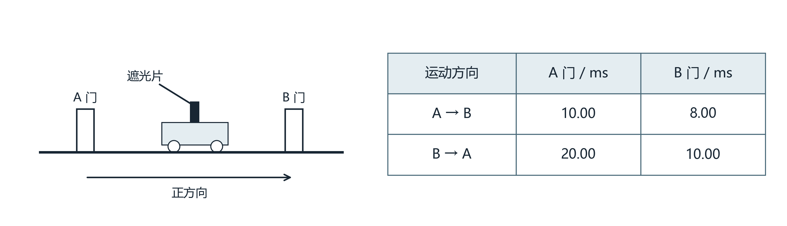
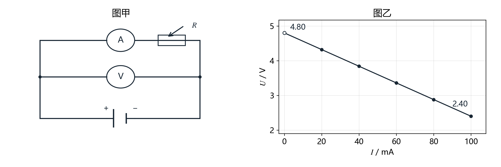
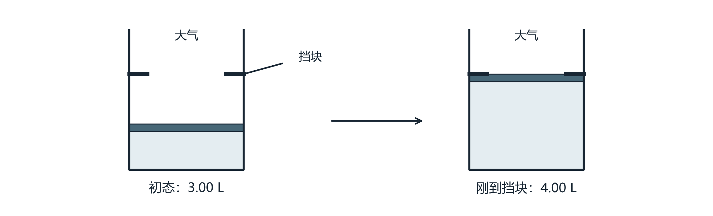
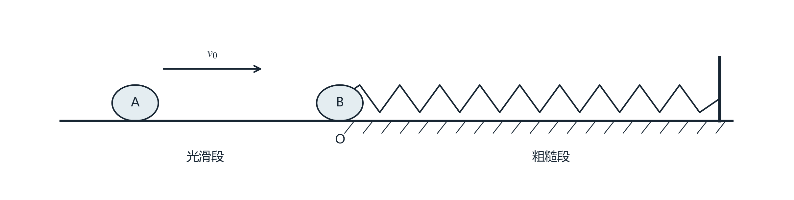
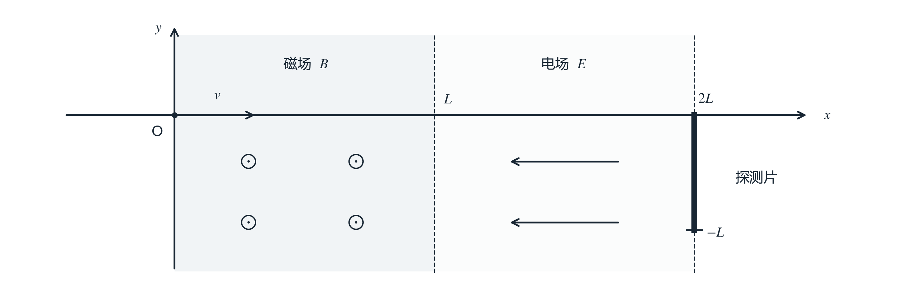

# 河南新高考物理模拟试卷

满分 100 分，考试时间 75 分钟。

## 单项选择题

### 1.（4 分）

用频率分别为 \(\nu_1\)、\(\nu_2\) 的单色光照射同一金属阴极，均发生光电效应，且 \(\nu_2>\nu_1\)。保持频率不变，增大较低频率光束的强度。下列说法正确的是（　　）

A．金属的逸出功增大

B．较高频率光束对应的遏止电压较大

C．较低频率光束对应的光电子最大初动能增大

D．只要较低频率光束足够强，其对应的遏止电压就会反超

### 2.（4 分）

行李箱放在列车水平地板上。列车沿直线向东行驶，先匀速，随后以恒定加速度制动至停，箱子全程相对列车静止。下列说法正确的是（　　）

A．匀速时，箱子受到向东的静摩擦力

B．制动时，地板对箱子的支持力小于箱子的重力

C．箱子未相对列车滑动，故制动时其所受静摩擦力不做功

D．以地面为参考系，制动时静摩擦力对箱子做负功

### 3.（4 分）

一卫星原在半径为 \(r\) 的圆轨道上运动。卫星在 P 点沿速度方向瞬时加速后进入椭圆轨道，P 为椭圆近地点。忽略推力结束后的非引力作用。下列说法正确的是（　　）

A．短时加速结束的瞬间，卫星所受地球引力与加速前相同

B．进入椭圆轨道后，卫星的机械能随其离地心距离增大而减小

C．椭圆轨道的运行周期小于原圆轨道的运行周期

D．卫星通过椭圆远地点时的速率大于通过 P 点时的速率

### 4.（4 分）

理想变压器原、副线圈匝数比为 \(3:1\)，原线圈接有效值恒定的正弦交流电源，副线圈只接一只定值电阻。再在副线圈两端并联一只阻值与它相同的电阻。与并联前相比，下列说法正确的是（　　）

A．原线圈两端电压的有效值增大一倍

B．副线圈两端交变电压的频率减半

C．原线圈电流的有效值变为原来的 2 倍

D．原有电阻消耗的功率变为原来的 2 倍

### 5.（4 分）

某透明材料对红光、紫光的折射率分别为 \(1.50\)、\(1.60\)。一束含红、紫两种单色光的窄光束从材料内部射向材料与空气的平界面。入射角的正弦为 \(0.64\)，空气折射率取 1。下列说法正确的是（　　）

A．两种光均能折射进入空气

B．红光能折射进入空气，紫光发生全反射

C．紫光能折射进入空气，红光发生全反射

D．紫光在材料中的传播速率比红光大

### 6.（4 分）

边长为 \(l\) 的单匝正方形闭合金属框总电阻为 \(R\)。它在水平面内以恒定速度垂直于磁场的直线边界进入磁感应强度为 \(B\) 的匀强磁场，前边与边界平行。磁场垂直于框面。忽略自感。从前边刚进入到后边刚进入，通过线框某截面的电荷量的大小为 \(q\)，线框产生的焦耳热为 \(Q\)。若将进场的速率变为原来的 2 倍，则（　　）

A．\(q\) 与 \(Q\) 均不变

B．\(q\) 变为原来的 2 倍，\(Q\) 不变

C．\(q\) 不变，\(Q\) 变为原来的 4 倍

D．\(q\) 不变，\(Q\) 变为原来的 2 倍

### 7.（4 分）

水平传送带工作段长 \(3.0\ \mathrm m\)，以 \(2.0\ \mathrm{m/s}\) 的速率向右匀速运行。两个质量相等的物块先后从工作段最左端放上带面，初速度都沿带面，甲的初速度为零，乙的初速度向右、大小为 \(4.0\ \mathrm{m/s}\)。两物块与带面间的动摩擦因数均为 \(0.20\)，取 \(g=10\ \mathrm{m/s^2}\)，忽略放置过程。下列说法正确的是（　　）

A．两物块各自从左端运动到右端的过程中，物块与传送带间产生的热量相等

B．两物块从左端运动到右端所用时间相同

C．到达右端前，乙与传送带已共同匀速运动了一段距离

D．从放上带面到达右端，摩擦力对甲、乙做的功相等

## 多项选择题

### 8.（6 分）

本组每题 6 分。全选对得 6 分，少选且无错得 3 分，有选错选项得 0 分。

两列振幅均为 \(A\) 的简谐横波沿同一直线传播，传播方向相反，波长均为 \(0.80\ \mathrm m\)。在两列波均已到达的区域中，它们在 \(x=0\) 处始终同相。下列说法正确的是（　　）

A．\(x=0.20\ \mathrm m\) 处的质点始终在平衡位置

B．\(x=0.10\ \mathrm m\) 处的质点振幅为 \(2A\)

C．\(x=0.10\ \mathrm m\) 与 \(x=0.30\ \mathrm m\) 处质点的振动反相

D．\(x=0.40\ \mathrm m\) 处的质点振幅为 \(2A\)

### 9.（6 分）

一轻弹簧竖直固定在水平地面上。质量均为 \(m\) 的甲、乙两块叠放在弹簧顶端，甲在上，乙与弹簧相连，两块只能沿竖直线运动。弹簧劲度系数为 \(k\)，系统平衡时再将两块一起向下压 \(3mg/k\) 后由静止释放。弹簧始终在弹性限度内。下列说法正确的是（　　）

A．释放瞬间，两块的加速度大小为 \(3g/2\)

B．两块第一次向上经过系统原平衡位置时立即分离

C．两块第一次分离时的速率为 \(g\sqrt{3m/(2k)}\)

D．从第一次分离到甲首次到达最高点，甲上升的高度为 \(5mg/(4k)\)

### 10.（6 分）

电容分别为 \(C\) 和 \(2C\) 的两只平行板电容器甲、乙，甲充至电压 \(U\) 后与电源断开，乙未充电。将两只电容器通过电阻并联，忽略漏电。下列说法正确的是（　　）

A．达到稳定后，两只电容器各自所带的电荷量相等

B．达到稳定后，两只电容器的电压均为 \(U/3\)

C．从接通至稳定，电阻产生的焦耳热为 \(CU^2/3\)

D．稳定后将乙断开，再增大乙两板间的距离，其电压保持不变

## 解答题

### 11.（6 分）

某同学用图示导轨研究小车所受阻力。导轨未完全调平，A、B 两光电门间距 \(0.500\ \mathrm m\)。小车同一遮光片的宽度为 \(12.0\ \mathrm{mm}\)，以宽度除以遮光时间作为过门速率。小车所受沿轨阻力大小恒定、方向总与速度相反。往返各做一次，过门数据见图。

（1）小车从 A 向 B 运动时，通过 B 门的速率为多少？

（2）分别求两次运动的加速度大小和方向，以 A 指向 B 为正方向。

（3）导轨哪端较低？求阻力与小车质量之比。

### 12.（9 分）

某同学按图甲测量电源的电动势和内阻。电流表视为理想，电压表内阻为 \(120\ \Omega\)。改变滑动变阻器的阻值，记录电流表示数 \(I\) 和电压表示数 \(U\)，得到图乙，电源在实验中可视为稳定。

（1）由图乙求直线的纵截距及斜率，斜率用 \(\Omega\) 表示。

（2）用 \(I\)、\(U\) 表示流过电源的电流，并求电源的电动势、内阻。

（3）若按理想电压表直接用该图线处理，所得电动势和内阻分别偏大还是偏小？简述原因。

### 13.（10 分）

竖直气缸内封有一定质量的理想气体。活塞无摩擦，质量为 \(20\ \mathrm{kg}\)，面积为 \(0.010\ \mathrm{m^2}\)。活塞上方大气压恒为 \(1.00\times10^5\ \mathrm{Pa}\)。
初态温度为 \(300\ \mathrm K\)，体积为 \(3.00\ \mathrm L\)。缓慢加热至活塞刚到挡块，此时体积为 \(4.00\ \mathrm L\)。
活塞保持不动，继续加热至气体温度为 \(500\ \mathrm K\)。总吸热为 \(720\ \mathrm J\)，取 \(g=10\ \mathrm{m/s^2}\)。

（1）求活塞刚到挡块时气体的温度及末态压强。

（2）求全过程气体对外做的功和内能的改变量。

### 14.（12 分）

水平轨道上，O 点左侧光滑、右侧粗糙。质量为 \(1.0\ \mathrm{kg}\) 的小物块 A 从左侧以一定速度向右运动，与静止在 O 点的等质量小物块 B 碰撞后粘在一起。两物块可视为质点。轻弹簧左端位于 O，右端固定，与物块不粘连，初始为原长。弹簧劲度系数为 \(32\ \mathrm{N/m}\)，粗糙段的动摩擦因数为 \(0.20\)，最大静摩擦力等于滑动摩擦力，取 \(g=10\ \mathrm{m/s^2}\)。碰撞时间极短，忽略碰撞期间外力的冲量，轨道和弹簧的有效行程足够长。

（1）若 A 的初速度大小为 \(8.0\ \mathrm{m/s}\)，求碰后共同速度的大小及弹簧最大压缩量。

（2）若要求两物块反弹后能以非零速度越过 O 点，求 A 的初速度大小应满足的条件，并说明临界情况下两物块的运动。

### 15.（17 分）

如图，在 \(0<x<L\) 的区域有垂直纸面向外的匀强磁场，磁感应强度大小 \(B>0\) 且可调；在 \(L<x<2L\) 的区域有沿 \(x\) 轴负方向的匀强电场。质量为 \(m\)、电荷量为 \(q\)（\(q>0\)）的粒子从 O 点以速率 \(v\) 沿 \(x\) 轴正方向射入，电场强度大小为 \(mv^2/(4qL)\)。忽略重力，边界不产生额外冲量。粒子与磁场右边界相切而未越过时仍按磁场中的圆弧运动。到达 \(x=2L\) 即视为到达探测平面，包括恰在该平面上沿 \(x\) 方向速度为零的情形。只讨论粒子第一次自左向右穿过 \(x=L\)（若能穿过）后的探测。

（1）令 \(s=qBL/(mv)\)。求能从磁场右侧进入电场的 \(s\) 的范围，并用 \(s\) 表示粒子入电场时的速度分量。

（2）求粒子能到达探测平面的 \(s\) 的范围，以及此时粒子在电场中的运动时间。

（3）若探测片仅覆盖探测平面上 \(-L\le y\le0\) 的区段，求粒子被探测片接收的 \(s\) 的范围，并说明其唯一临界值的依据。
