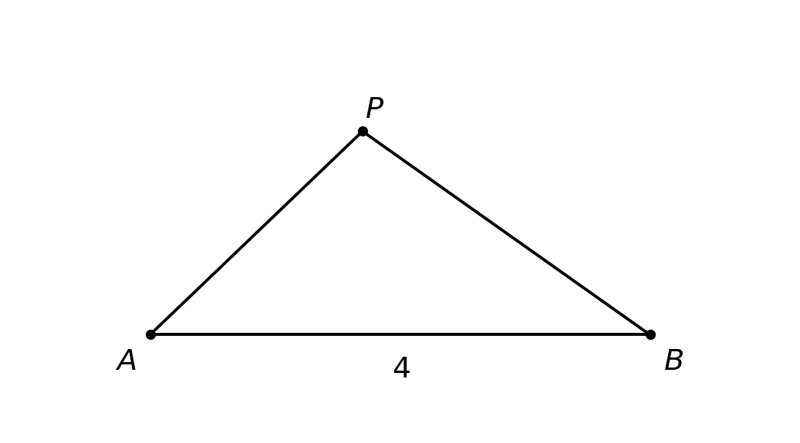
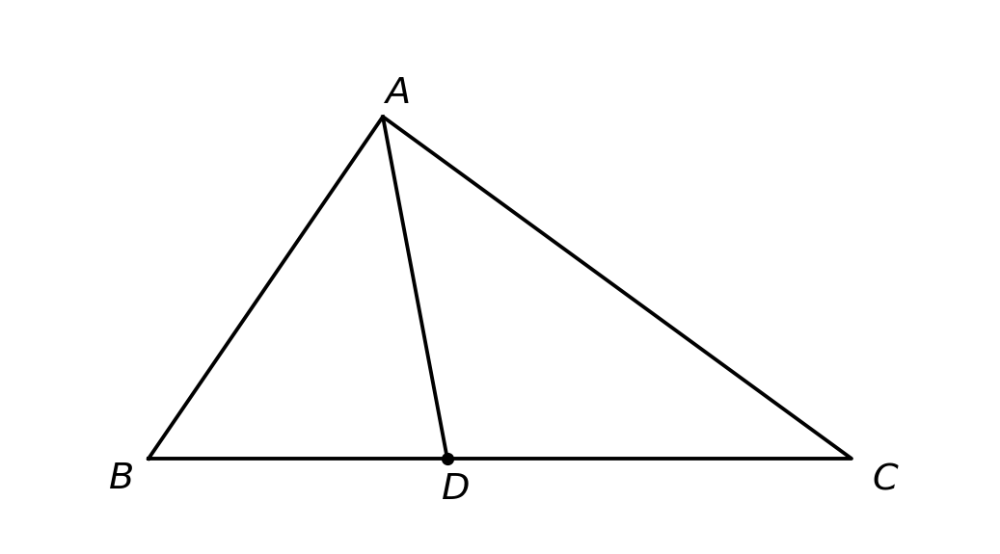
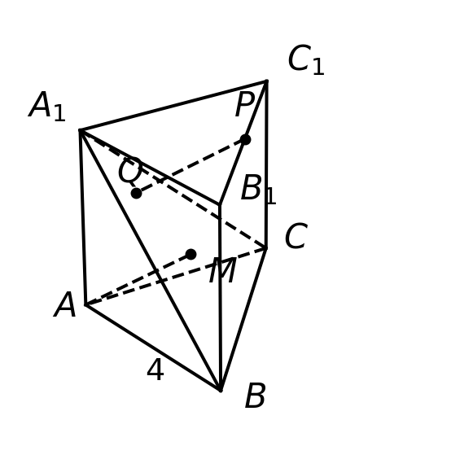
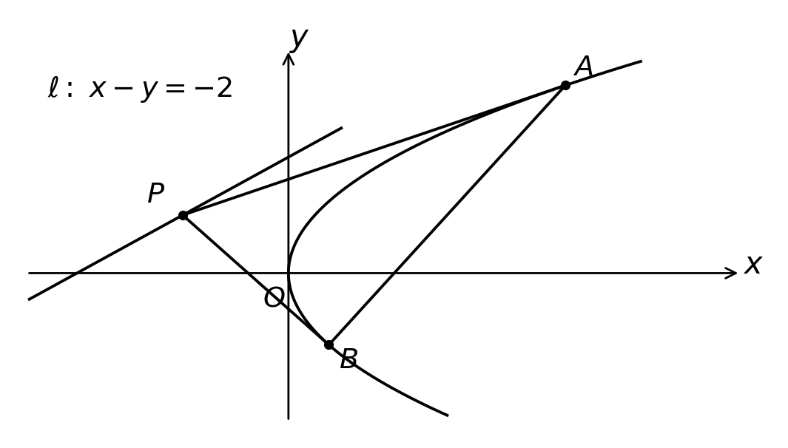

# 河南新高考数学标准模拟卷

满分150分，考试时间120分钟。

## 一、单项选择题

本大题共8小题，每小题5分，共40分。在每小题给出的四个选项中，只有一项是符合题目要求的。

## 1.（5分）

设全集 \(U=\{1,2,3,4,5,6\}\)，\(A\) 为 \(U\) 中所有能整除 \(6\) 的数构成的集合，\(B=\{2,4,6\}\)。则 \((U\setminus A)\cup B\) 中元素的个数为
A．\(2\)
B．\(3\)
C．\(4\)
D．\(5\)

## 2.（5分）

设 \(i\) 为虚数单位，复数 \(z\) 满足 \((1+2i)z=3+i\)，则 \(|z-i|=\)
A．\(1\)
B．\(\sqrt2\)
C．\(2\)
D．\(\sqrt5\)

## 3.（5分）

已知平面向量 \(\mathbf a=(1,2)\)，\(\mathbf b=(3,-1)\)。若 \(\mathbf a+t\mathbf b\) 与 \(\mathbf b\) 垂直，则实数 \(t=\)
A．\(-\frac{1}{10}\)
B．\(\frac{1}{10}\)
C．\(-\frac13\)
D．\(2\)

## 4.（5分）

甲组的 \(6\) 个测量记录的平均数为 \(8\)，乙组的 \(4\) 个测量记录的平均数为 \(11\)。后发现甲组有 \(2\) 个记录各偏高 \(3\)。更正后，两组合并的平均数为
A．\(8.9\)
B．\(9.2\)
C．\(9.0\)
D．\(8.6\)

## 5.（5分）

设 \(f(x)=2\sin(\omega x-\pi/6)\)，其中 \(\omega>0\)。已知 \(f(x)\) 的最小正零点为 \(\pi/12\)，则 \(f(\pi/3)=\)
A．\(\sqrt3\)
B．\(2\)
C．\(1\)
D．\(0\)

## 6.（5分）

等差数列 \(\{a_n\}\) 的前 \(n\) 项和为 \(S_n\)。已知 \(S_4=14\)，\(S_8=44\)，则 \(a_7=\)
A．\(8\)
B．\(7\)
C．\(9\)
D．\(\dfrac{15}{2}\)

## 7.（5分）

某道工序将编号 \(1,2,3,4,5\) 的五个信号各发一次。要求 \(1\) 和 \(2\) 相邻，\(3\) 在 \(1\) 之前，且 \(4\) 不是首个信号。符合要求的发送次序有
A．\(9\)
B．\(18\)
C．\(21\)
D．\(24\)

## 8.（5分）

设 \(m\) 为正整数。若关于 \(x\) 的方程 \(|x^2-4x+3|+\dfrac m4|x-2|=1\) 恰有五个不同实根，则所有满足条件的 \(m\) 的和为
A．\(3\)
B．\(5\)
C．\(6\)
D．\(10\)

## 二、多项选择题

本大题共3小题，每小题6分，共18分。在每小题给出的四个选项中，有多项符合题目要求。全部选对得满分，选对但不全得3分，有选错的得0分。

## 9.（6分）

已知复数 \(z,w\) 满足 \(|z|=1\)，\(|w|=2\)，\(z+w=\sqrt5\)。下列说法正确的是
A．\(z\) 的实部为 \(1/\sqrt5\)
B．\(|z-w|=\sqrt5\)
C．乘积为纯虚数
D．\(z^2+w^2\) 的虚部为 \(0\)

## 10.（6分）

盒中有 \(4\) 个白球和 \(3\) 个黑球。从中不放回依次随机取出 \(3\) 个球。记事件 \(X\) 为“首尾两球同色”，\(Y\) 为“第二个球为白球”。下列说法正确的是
A．已知 \(X\)，三球同色的概率为 \(1/7\)
B．若三个球恰有两个白球，则 \(X\) 发生的概率为 \(1/3\)
C．\(P(Y\mid X)=8/15\)
D．\(P(X\mid Y)>P(X\mid Y^c)\)

## 11.（6分）

如图，点 \(P\) 在直线 \(AB\) 的上方运动，且 \(|PA|+|PB|=6\)。下列说法正确的是

A．\(|PA||PB|\) 的最大值为 \(9\)
B．\(P\) 到直线 \(AB\) 的距离最大值为 \(3\)
C．\(\cos\angle APB\) 的取值范围为 \((1/9,1]\)
D．若 \(\angle PAB=60^\circ\)，则 \(|PA|=5/2\)

## 三、填空题

本大题共3小题，共15分。请将答案填在横线上。

## 12.（5分）

曲线 \(y=x^3-3x\) 上有两条切线与直线 \(y=9x+2\) 平行。这两条切线在 \(y\) 轴上截距之差的绝对值为 ________。

## 13.（5分）

\((1+2x)^5(1-x)^2\) 的展开式中，\(x^2\) 的系数为 ________。

## 14.（5分）

三个实数之和为 \(6\)，平方和为 \(14\)。把这三个数从小到大排列，中间那个数的取值范围为 ________。

## 四、解答题

本大题共5小题，共77分。解答应写出文字说明、证明过程或演算步骤。

## 15.（13分）

如图，\(\triangle ABC\) 中，角 \(A\) 的平分线与图示边交于 \(D\)。角 \(A,B,C\) 的对边分别为 \(a,b,c\)，且 \(b+c=6\)。

（1） 用 \(b,c,A\) 表示 \(|AD|\)。
（2） 若 \(|AD|=2\)，求 \(a\) 的取值范围。

## 16.（15分）

如图，在直三棱柱 \(ABC-A_1B_1C_1\) 中，\(\angle BAC=90^\circ\)，\(AB=AC=AA_1\)，棱长如图所示。点 \(M\) 为 \(\triangle A_1BC\) 的重心，点 \(P\) 在棱 \(B_1C_1\) 上运动，\(Q\) 为 \(P\) 到平面 \(A_1BC\) 的垂足。

（1） 证明：\(AM\perp\) 平面 \(A_1BC\)。
（2） 若 \(Q\) 在 \(\triangle A_1BC\) 的内部或边上，求 \(B_1P/B_1C_1\) 的取值范围。
（3） 在第（2）问的条件下，求直线 \(AP\) 与平面 \(A_1BC\) 所成角的正弦值的取值范围。

## 17.（15分）

某装置依次读取独立发出的标记。每次读到甲类、乙类的概率分别为 \(2/3,1/3\)。首次出现相邻两个标记类别不同时，装置报警。记首次报警发生在第 \(T\) 次读取。
（1） 求 \(P(T=3)\)。
（2） 设 \(N\ge2\) 为整数，读取至多 \(N\) 次。求实际读取次数的数学期望。
（3） 若已读取 \(n\) 次（\(n\ge1\)）仍未报警，求下一次读取报警的条件概率，并求它不超过 \(7/20\) 时 \(n\) 的最小值。

## 18.（17分）

在抛物线 \(C:y^2=4x\) 的两点 \(A,B\) 处作切线，两切线相交于 \(P(u,v)\)。设 \(P\) 在图示直线 \(\ell\) 上运动。

（1） 写出直线 \(AB\) 的方程（用 \(u,v\) 表示），并证明 \(AB\) 过定点。
（2） 求 \(|AB|\) 的最小值及取得最小值时点 \(P\) 的坐标。
（3） 若把 \(\ell\) 改为 \(u=\lambda v/2-(\lambda^2+4)/4\)，其中 \(\lambda\ge0\)，讨论取得最短弦长时点 \(P\) 的个数，并求相应的最短弦长。

## 19.（17分）

对三次函数 \(P(x)=x^3+u x^2+v x+w\)，记 \(D(P)\) 为 \(|P(x)|\) 在闭区间 \([-1,1]\) 上的最大值。
（1） 令 \(P_0(x)=x^3-3x/4\)，求 \(D(P_0)\)。
（2） 求 \(D(P)\) 的最小值，并确定达到最小值的所有函数 \(P\)。
（3） 若 \(D(P)\leq1/2\)，求一次项系数 \(v\) 的取值范围。
