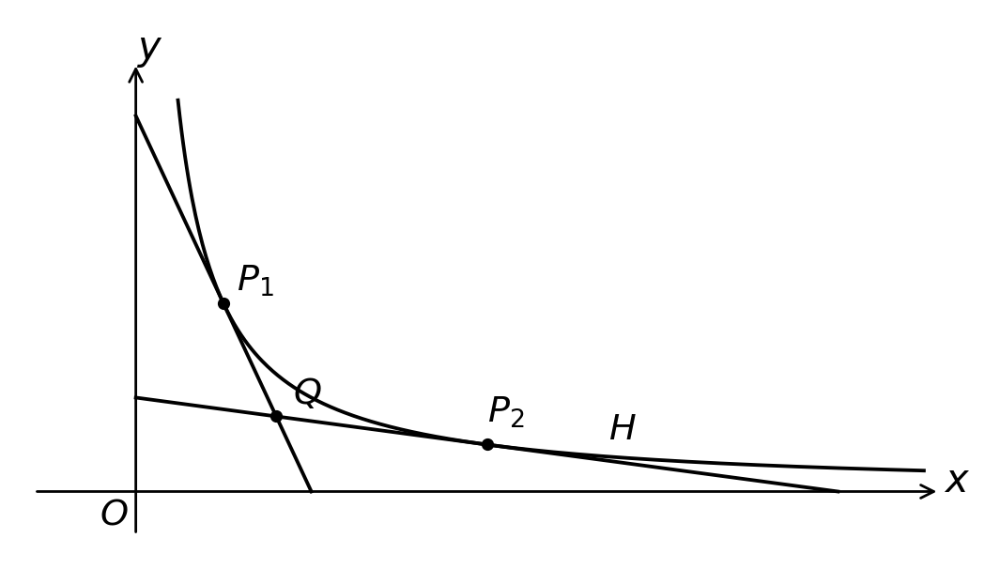

# 2027 河南数学趋势研判专题

满分45分，考试时间55分钟。

## 一、多项选择题

本大题共1小题，每小题6分，共6分。在每小题给出的四个选项中，有多项符合题目要求。全部选对得满分，选对但不全得3分，有选错的得0分。

## 1.（6分）

将 \(1\) 至 \(6\) 号灯按编号顺序围成一圈，\(6\) 号灯与 \(1\) 号灯相邻。开始时各灯均熄灭。每次可选一对相邻的灯，将这两盏灯的状态各翻转一次（亮的变灭，灭的变亮）。下列说法正确的是
A．任意指定偶数盏灯，均可使恰好这些灯点亮
B．使仅 \(1,4\) 号灯点亮，至少要操作 \(3\) 次
C．任意指定四盏灯，均可恰好操作 \(2\) 次使仅这四盏灯点亮
D．恰好操作 \(4\) 次可以使六盏灯全部点亮

## 二、填空题

本大题共1小题，共5分。请将答案填在横线上。

## 2.（5分）

设 \(\alpha,\beta\in(0,\pi/2)\)，\(\tan\alpha+\tan\beta=4\)，\(\tan|\alpha-\beta|=1/2\)。则 \(\tan(\alpha+\beta)=\) ________。

## 三、解答题

本大题共2小题，共34分。解答应写出文字说明、证明过程或演算步骤。

## 3.（17分）

如图，曲线 \(H:xy=1\ (x>0)\) 的切线与两坐标轴围成一个三角形。

（1） 设 \(P(t,1/t)\) 是 \(H\) 上一点，求 \(H\) 在 \(P\) 处的切线方程及相应的三角形面积。
（2） 设 \(Q(a,b)\) 位于第一象限，求从 \(Q\) 可作 \(H\) 的两条不同切线的充要条件。
（3） 在第（2）问的条件下，如图用两条切线分别围成两个三角形。两三角形覆盖区域的面积记为 \(S\)。若 \(3/4\leq ab<1\)，求 \(S\) 的取值范围。

## 4.（17分）

将四个实数 \(a,b,c,d\) 按顺序排成一圈。每轮同时把各位置的数替换成该数与顺时针下一位置原数的平均数。记 \(R_n\) 为第 \(n\) 轮后这四个数的最大值与最小值之差，\(R_0\) 为初始四数的最大值与最小值之差。
（1） 证明四个数的算术平均数在每轮后保持不变，并写出第一轮后四个数相等的充要条件。
（2） 证明对所有整数 \(n\ge1\)，均有 \(R_{n+2}=R_n/2\)。
（3） 证明 \(R_2\leq R_0/2\)，并用 \(a,b,c,d\) 表示等号成立的充要条件。
