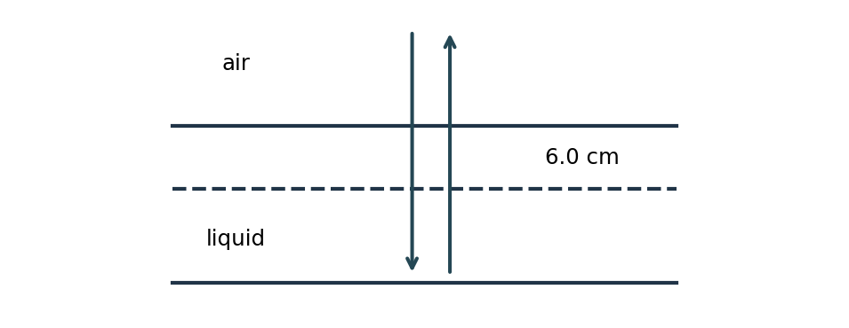
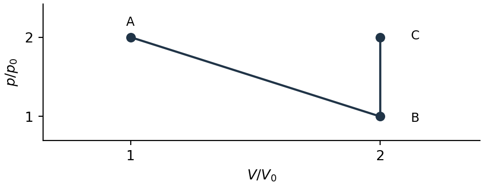
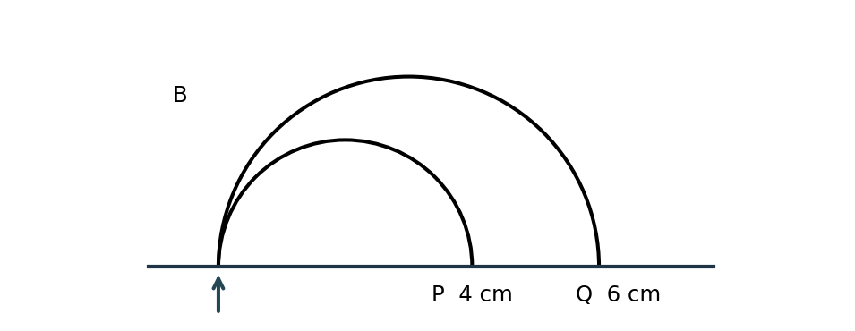
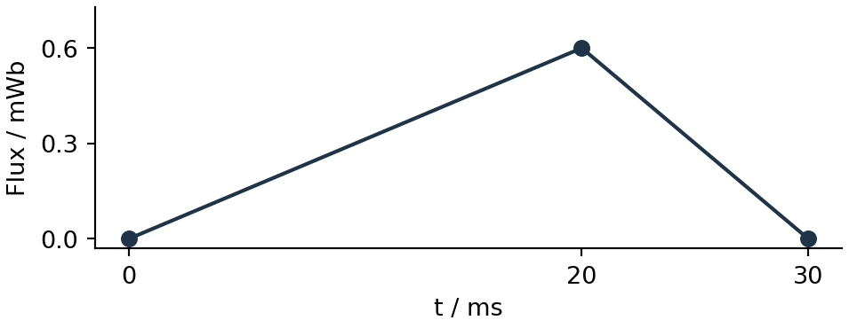
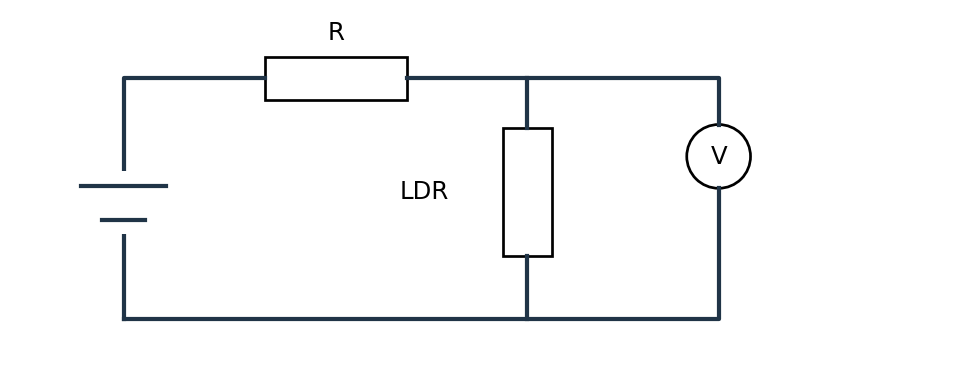
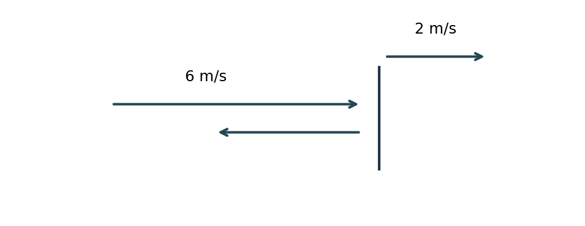

# 河南普通高中学业水平选择性考试 · 物理模拟 A 卷

满分100分，考试时间75分钟。

## 一、单项选择题

本大题共7小题，每小题4分，共28分。在每小题给出的四个选项中，只有一项是符合题目要求的。

## 1.（4分）

天文台在一团稀薄气体的发射光谱中找到两条谱线。图示原子的三个能级为 0、2.0、5.0 eV，只考虑这三个能级之间的单光子跃迁。从最高能级直接跃迁到基态发出的光，跟先后经中间能级跃迁发出的两束光相比，其

A．波长等于后两束光的波长之和
B．频率等于后两束光的频率之和
C．波长等于后两束光的波长之差
D．频率等于后两束光的频率之差

## 2.（4分）

一颗卫星在近球形小天体表面附近绕其做匀速圆周运动，测得周期为 T。随后测得另一颗卫星在同一天体外半径为前者 4 倍的圆轨道上运动。忽略小天体自转，若只使用上述数据和引力常量，可以确定
A．小天体的质量和外轨卫星的速率
B．小天体的半径和表面重力加速度
C．小天体的平均密度和外轨卫星的周期
D．内轨卫星的线速度和外轨卫星的加速度

## 3.（4分）

测深仪用一束与液面垂直的短光脉冲照射槽底，探头固定在液面上方。图示槽底不动，液面升高 6.0 cm，槽底回波比原来迟 0.20 ns，空气中光速取 \(3.00\times10^8\) m/s。液体的折射率为

A．1.25
B．1.50
C．2.00
D．2.50

## 4.（4分）

用一定量理想气体校核压力传感器。图中 A、B、C 的体积、压强坐标依次为（V₀，2p₀）、（2V₀，p₀）、（2V₀，2p₀），A 到 B 沿直线变化，B 到 C 等容。关于 A 到 B 的过程，下列说法正确的是

A．气体放热，因为终态压强降低
B．气体不吸热也不放热，因为两端温度相同
C．温度单调升高，气体吸热
D．温度先升后降，吸热量为 \(1.5p_0V_0\)

## 5.（4分）

一束正离子以相同速率垂直射入均匀磁场，经半周偏转回到入射边界。探测板图上 P、Q 两峰距入射点分别为 4.0 cm、6.0 cm，离子电荷量分别为 e、2e。两峰对应的离子动能之比 \(E_P:E_Q\) 为

A．1∶3
B．2∶3
C．3∶4
D．4∶3

## 6.（4分）

电磁流量探头的校验线圈有 100 匝，电路总电阻 5.0 Ω，自感可忽略。图示每匝磁通量从 0 线性增至 0.60 mWb，用时 20 ms，再用 10 ms 线性降回零。第二段与第一段相比较

A．通过导线截面的电荷量大小为第一段的两倍
B．电流大小为第一段的一半
C．产生的焦耳热为第一段的两倍
D．产生的焦耳热与第一段相同

## 7.（4分）

水平圆盘上有两个相同小盒，距轴为 r 与 2r，由一条沿半径的轻绳连接。两盒与盘的最大静摩擦力均为其重力的 μ 倍。缓慢增大角速度，两盒与盘相对静止，绳保持拉直。两盒均能随盘转动的最大角速度的平方为
A．\(\mu g/(2r)\)
B．\(2\mu g/(3r)\)
C．\(3\mu g/(4r)\)
D．\(\mu g/r\)

## 二、多项选择题

本大题共3小题，每小题6分，共18分。在每小题给出的四个选项中，有多项符合题目要求。全部选对得满分，选对但不全得3分，有选错的得0分。

## 8.（6分）

环境记录仪的分压电路如图。理想恒压源接串联的定值电阻 R 与光敏电阻，电压表并联在光敏电阻两端。暗处光敏电阻为 2R，明处为 R；电表内阻为 2R。从暗处移到明处，下列说法正确的是

A．表示数由电源电压的 1/2 降至 2/5
B．流过定值电阻的电流减小
C．光敏电阻两端的实际电压等于拆去电表时的电压
D．电表消耗的功率变为原来的 16/25

## 9.（6分）

水平横梁受竖直向下的载荷，通过左右两根质量不计的斜索悬挂在顶棚。忽略梁重，两索与水平的夹角分别为 30° 和 60°，载荷位置保证平衡。两根索的允许最大拉力均为 F。以下判断正确的是
A．右索的拉力为左索的 \(\sqrt3\) 倍
B．增加载荷时左索先达到允许最大拉力
C．吊起的最大载荷重为 \(2F/\sqrt3\)
D．左索的水平分力是右索的三倍

## 10.（6分）

一轻质挡板在水平面内正对连续水流，把入射水流沿原直线反向送回。水相对地面以 6 m/s 射向挡板，水束的质量线密度恒定。图示挡板先静止，再以 2 m/s 沿水流入射方向匀速移动。水相对挡板的碰前、碰后速率相等。与静止时相比，移动时

A．单位时间撞上挡板的水的质量变为原来的 2/3
B．撞上挡板的每千克水的动量改变量大小变为原来的 1/3
C．水流推力变为原来的 4/9
D．水离板后的对地速度大小仍为 6 m/s

## 三、非选择题

本大题共5小题，共54分。按题意填写或作答。计算题须写出必要的文字说明、方程式和演算步骤。

## 11.（6分）

测量重力加速度时，小组把悬点到球顶的线长记作 L，球半径始终相同。小角度摆动，测得 \(T^2\) 对 L 的拟合线斜率为 4.03 s²/m，纵轴截距为 0.0403 s²。
（1） 根据单摆周期公式，球的半径为 ①________ cm，当地重力加速度为 ②________ m/s²（保留三位有效数字）。
（2） 若把线长 L 直接当作摆长，逐组用周期计算重力加速度，所得结果比实际值 ③________（填“偏大”或“偏小”）。

## 12.（9分）

将电容器充电后断开充电电源，通过电阻箱放电。内阻未知的电压记录器始终并联在电容器上。电压降至初值的 \(1/e\) 所用时间记为 τ。用 100 kΩ、200 kΩ 电阻箱档位，测得 τ 分别为 0.80 s、1.20 s；漏电仅来自记录器。
（1） 设记录器内阻为 \(R_v\)，电容为 C。放电支路的总电导为 ①________（用电阻箱阻值 R 和 \(R_v\) 表示）。已知 τ 为等效电阻与 C 的乘积，以 \(1/R\) 为横轴、\(1/\tau\) 为纵轴，斜率为 ②________。
（2） 由两组数据得 C 为 ③________ μF，\(R_v\) 为 ④________ kΩ。
（3） 若将记录器视为理想电压表，直接用 τ/R 估算 C，所得结果 ⑤________（填“偏大”或“偏小”）。

## 13.（10分）

一只密闭刚性薄壳浮标质量为 2.4 kg，外部体积为 3.0 L，初始时在水中静止漂浮。忽略空气浮力和水阻力，取水密度 1.0×10³ kg/m³，g=10 m/s²。
（1） 求静止漂浮时浮标露出水面的体积。
（2） 用细线将浮标完全浸没并固定，撤去细线。求其完全浸没期间的加速度，以及从静止上浮 0.50 m 后的速率（此段始终完全浸没）。

## 14.（12分）

单匝矩形线圈面积为 0.020 m²，在 0.50 T 匀强磁场中绕位于线圈面内且垂直于磁场的轴匀速转动。线圈内阻 1.0 Ω，外接 3.0 Ω 加热电阻，转动角速度为 200 rad/s。忽略机械摩擦与自感。
（1） 求感应电动势最大值和外电阻的平均发热功率。
（2） 令转速变为原来的两倍。若要使外电阻平均发热功率与原来相同，外电阻应改为何值？求出全部正值。

## 15.（17分）

一块质量为 \(2m\) 的长板放在光滑水平面上，板左侧有固定竖直挡墙。质量为 m 的小包从板左端以水平速度 v 向右滑上静止长板，包与板间动摩擦因数为 μ。待二者开始共同向右运动时，板的右端触发短时制动器，使板的速度瞬间反向且大小不变，随后制动器即脱开。制动瞬间对包的冲量忽略。板的总长为 L，起初板左端距挡墙为 d。包视为质点。若包滑出板边或板撞墙，则本次运行结束。取向右为正。
（1） 求首次共速时的速度和包相对板滑行的距离。
（2） 假定制动后的再次共速能够实现，求再次共速速度，以及制动后到再次共速期间板向左运动的距离。
（3） 若要求再次共速发生在包到达板右端及板碰墙之前，求 L 与 d 应满足的条件，计入制动前板已向右移动的距离。
