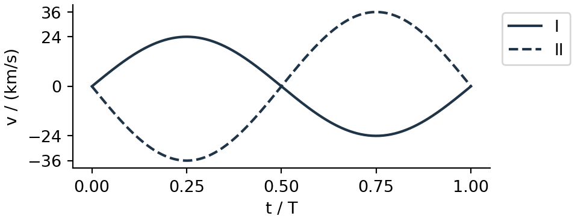
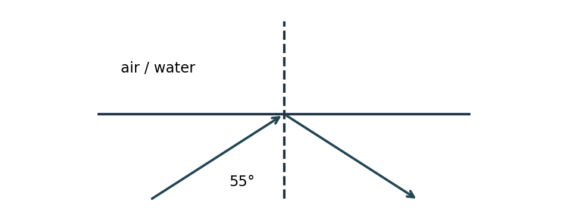
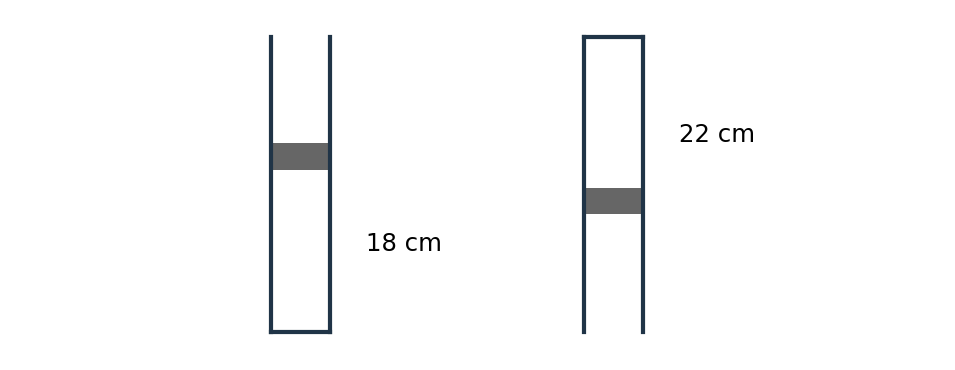
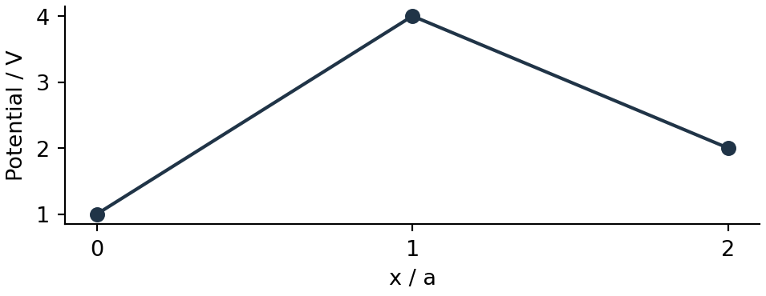
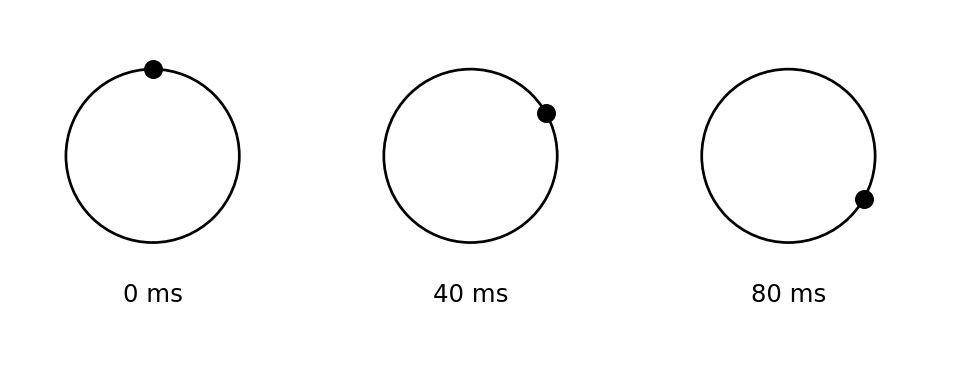
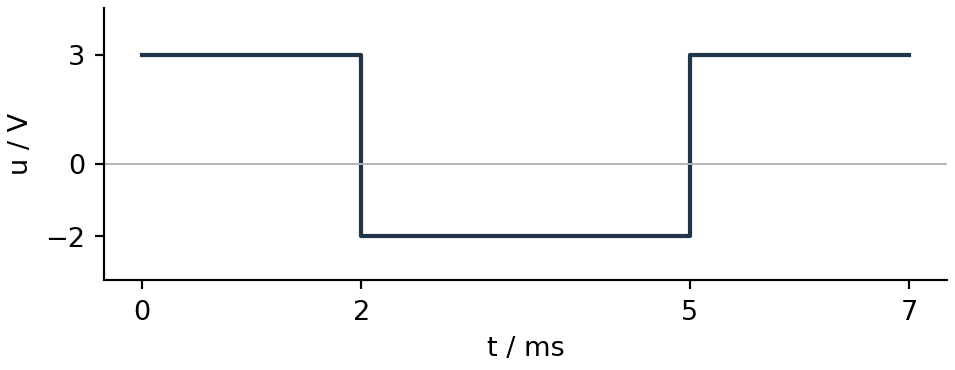
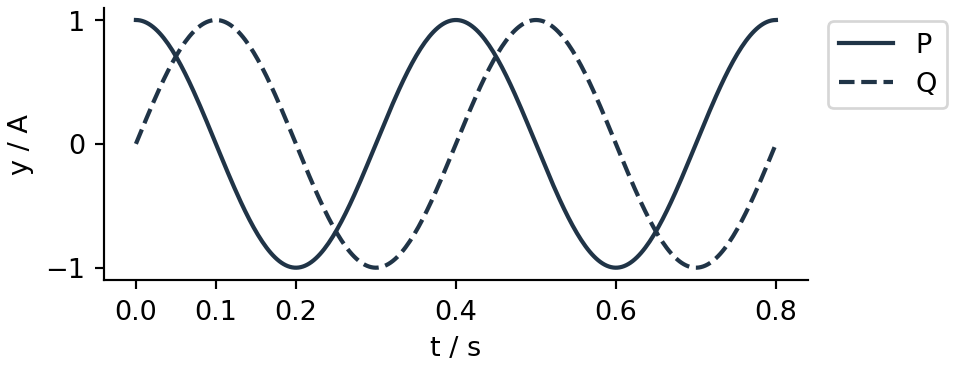
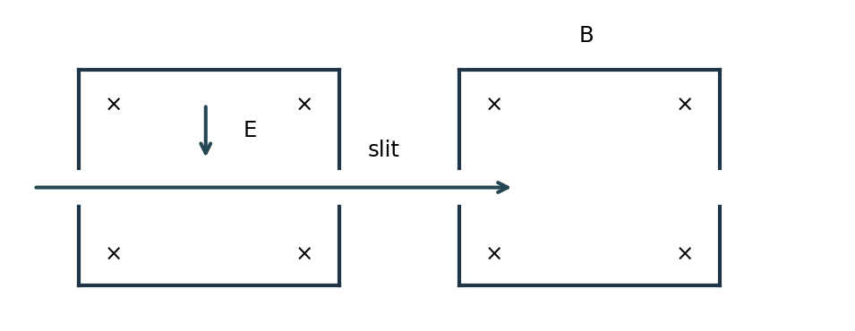

# 河南普通高中学业水平选择性考试 · 物理模拟 B 卷

满分100分，考试时间75分钟。

## 一、单项选择题

本大题共7小题，每小题4分，共28分。在每小题给出的四个选项中，只有一项是符合题目要求的。

## 1.（4分）

静止的氡原子核在真空中发生一次 α 衰变，仅生成 α 粒子和一个子核。忽略相对论效应。已知子核质量约为 α 粒子的 54 倍，此次释放的能量中转化为子核动能的比例约为
A．1/54
B．1/55
C．1/2916
D．54/55

## 2.（4分）

双星系统中两星视为质点，绕共同的圆心以相同角速度做圆周运动，外力忽略。观测方向平行于轨道平面。图中实线 I、虚线 II 所示两星相对系统质心的视向速度振幅分别为 24 km/s、36 km/s。I 星与 II 星的质量比、轨道半径比分别为

A．2∶3，2∶3
B．3∶2，3∶2
C．3∶2，2∶3
D．2∶3，3∶2

## 3.（4分）

一束光在平直透明棒内传播，在棒与外介质交界面的入射角为 55°，如图。棒的折射率为 1.50，外介质先为空气、后换作折射率 1.33 的水。取 \(\sin55^\circ=0.82\)。下列说法正确的是

A．两次均发生全反射，反射角相同
B．空气中发生全反射，换水后有光折入水中
C．水中发生全反射，空气中有光折出
D．换水后折射角小于 55°

## 4.（4分）

一端封闭的等截面细管内有一小段水银柱，将一定量理想气体与大气隔开。图示管口向上、管口向下时，气柱长度分别为 18 cm、22 cm，温度和外界大气压均相同，水银未流出。保持温度不变把管水平放置，气柱长度最接近

A．19.0 cm
B．19.8 cm
C．20.0 cm
D．20.2 cm

## 5.（4分）

静电透镜入口处，一负电荷由静止释放，沿 x 轴从 x=0 运动。图示电势随 x 的变化，在 0、a、2a 三处电势依次为 1 V、4 V、2 V，区间内由直线连接。忽略重力，关于第一次到达这些位置时的运动，下列说法正确的是

A．在两段内所受电场力大小之比为 2∶3
B．在第二段折返，不能到达 2a
C．在 2a 处速率与在 a 处速率之比为 \(1/\sqrt3\)
D．在 a 处加速度方向改变，速度方向也同时改变

## 6.（4分）

匀速转轮上有一个标记，照相机每隔 0.040 s 曝光一次。从同一侧看，三次曝光的标记如图，每次都相对上一次沿顺时针转过表观角 60°。独立测量表明实际转向为逆时针、转速小于每秒 30 转。实际转速约为

A．4.17 转/秒
B．16.7 转/秒
C．20.8 转/秒
D．29.2 转/秒

## 7.（4分）

铁芯上的检测线圈有 200 匝，另一个激励绕组通以周期性电流。忽略漏磁。检测线圈的开路电压如图，一个周期内先为 +3.0 V（持续 2.0 ms），再为 −2.0 V（持续 3.0 ms）。取 \(u=-N\,\mathrm d\Phi/\mathrm dt\)。若周期起点的每匝磁通量为 10 μWb，则

A．每周期结束时磁通量减少 30 μWb
B．磁通量最小值为 −20 μWb
C．电压有效值为 2.55 V
D．磁通量在第一个区间内保持恒定

## 二、多项选择题

本大题共3小题，每小题6分，共18分。在每小题给出的四个选项中，有多项符合题目要求。全部选对得满分，选对但不全得3分，有选错的得0分。

## 8.（6分）

水槽中两探头 P、Q 相距 0.45 m，简谐行波从 P 传向 Q。图中 P、Q 稳态记录周期均为 0.40 s，Q 的波峰比 P 最近的前一波峰晚 0.10 s。另测得波速在 0.75 m/s 至 2.0 m/s 之间。下列说法正确的是

A．同一波峰从 P 传到 Q 用时 0.10 s
B．波速为 0.90 m/s
C．波长为 0.36 m
D．同一时刻 P、Q 两点的位移之和恒为零

## 9.（6分）

图中正离子向右进入速度选择器，电场向下、磁场垂直纸面向里。调至基准值 \(E_0,B_0\) 时，离子从中线水平穿过窄缝，进入另一垂直磁场形成谱线。若入射离子束很细，含有一小段连续的速率分布，可近似认为能通过狭缝的离子均在选择区沿直线运动。保持两区磁场不变，略微增大选择区电场，狭缝后仍观测到同种离子的新谱线。下列判断正确的是

A．原来沿中线穿过的同速正离子在选择区的初始偏转向下
B．若只把电场方向反转，同一批向右运动的正离子仍能靠改变速率直线穿过
C．同种离子的新谱线对应较小的回转半径
D．只反转偏转区磁场，谱线换侧，同种离子回转半周的飞行时间不变

## 10.（6分）

颗粒置于竖直振动的水平托盘上，盘面高度变化为 \(y=A\cos(\omega t)\)，向上为正。在最低点颗粒已与盘同速，且在此后首次失去接触前与盘同步。已知 \(A\omega^2=2g\)。关于从最低点向上运动的这一段，下列判断正确的是
A．到达平衡位置时支持力等于重力
B．开始脱离时颗粒速度为零
C．首次脱离处在平衡位置上方 A/2
D．在最低点颗粒所受支持力为 2mg

## 三、非选择题

本大题共5小题，共54分。按题意填写或作答。计算题须写出必要的文字说明、方程式和演算步骤。

## 11.（6分）

小组要检验桌面上滚动的小球在一段时间内是否做匀减速运动。一把刻度尺与球心轨迹处在同一平面，相机正对该平面。以等时间间隔 0.050 s 取五帧，球心位置依次为 0、4.8、9.2、13.2、16.8 cm。另一个小组用相同布置，却将标尺移到球心轨迹后面、更远离镜头的位置。
（1） 由相邻两段位移之差检验模型，这些差均为 ①________ cm（规定向前为正）。第三帧球心的瞬时速度为 ②________ m/s。
（2） 若另一组用画面中距离更远的标尺直接换算球心位移，所得加速度大小会 ③________（填“偏大”或“偏小”）。为排除此误差，标尺应与 ④________ 共面并平行于运动方向。

## 12.（9分）

检修台上两根等长同规格导线远端短接。长度均为 100 m，其中一根距近端 x 处碰壳，接触电阻忽略。把均匀电阻丝 A、B 两端分别接故障线与完好线的近端，电源接在检修端可触及的导电外壳与滑动触头之间，忽略外壳电阻，电流计跨接 A、B。平衡时电流计指零，两条电缆到碰壳点的电阻比等于触头左右两段电阻丝的阻值比。电阻丝长 100.0 cm。
（1） 检测时，触头位于 30.0 cm 刻度，电流计偏左；位于 35.0 cm 时偏右。为得到更精细读数，应在 ①________ cm 至 ②________ cm 之间移动触头，直至电流计 ③________。
（2） 平衡时左段长为 32.0 cm，沿故障线近端到碰壳点长 x，沿完好线近端绕远端到碰壳点长 ④________（用 x 表示，单位 m）。故障点距离故障线近端 ⑤________ m。
（3） 若只在完好线近端额外串入一小段接线电阻，仍用上述理想长度关系反算，定位结果将 ⑥________（填“偏大”或“偏小”）。

## 13.（10分）

质量为 500 kg 的设备在竖直导轨内下行。发电装置提供向上、大小可控的制动力，另有恒定摩擦阻力 500 N。设备由静止开始匀加速下行 4.0 m 后达 4.0 m/s，随即在接下来的 2.0 m 内匀减速至静止。取 g=10 m/s²。
（1） 求两个阶段的制动力。
（2） 若两段中发电装置从机械能到电能的转化效率均为 80%，求储存的总电能。

## 14.（12分）

温差试验台中的一定量单原子理想气体由 A 经 B、C 返回 A。A 的状态为 \((V_0,p_0)\)，B 为 \((V_0,2p_0)\)，C 为 \((2V_0,p_0)\)。A→B 等容，B→C 在 p–V 图上为直线，C→A 等压。已知气体内能 \(U=3pV/2\)。
（1） 求每个循环气体对外做的净功，以及 A→B 的吸热量。
（2） 在 B→C 的直线段上，气体经过 \(V=1.6V_0\) 后是否仍继续吸热？确定热量由流入变为流出时的体积，并说明判据。可以取极短一段，用该段平均压强计算所做的功。

## 15.（17分）

光滑水平面上，两根平行理想导轨相距 l，左端跨接电容器 C；质量 m、电阻 R 的金属棒垂直横跨在导轨上。匀强磁场 B 竖直向上，电容器初始不带电。忽略回路自感与其他电阻。水平恒力 F 从静止起向右拉棒，直至电流首次达到最终稳定电流的一半，此刻撤去拉力。棒和导轨保持良好接触，电容器不击穿。以下取拉动阶段的电流方向为正，q 表示电容器正极板所带电荷量。
（1） 写出棒速 v、充电电流 I 和电荷量 q 的回路关系；设拉力作用时间为 t，写出从开始到 t 时刻系统的动量关系。
（2） 拉力长期作用时电流趋于恒定。用一小段时间内电压和速度的增量，求此稳定电流 \(I_s\) 以及稳定阶段的加速度。
（3） 撤力时的速度为 \(v_1\)。当回路电流再次趋于零，求棒的速度；说明撤力后电流是否会反向，并给出此段电阻所耗电能的求法（结果可用 \(I_s,v_1\) 及题给量表示）。
