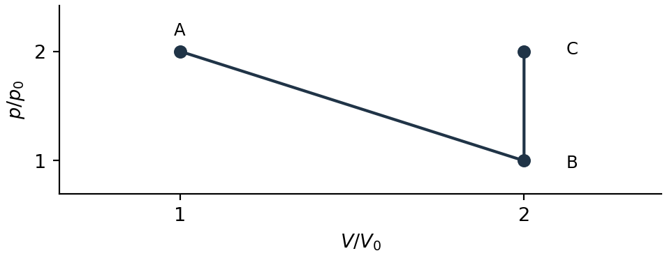
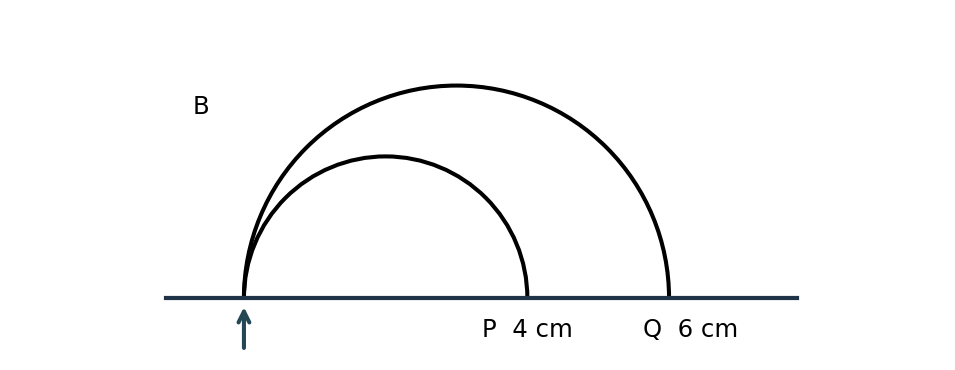

## 4 刚性容器的泄压过程
标定恒压阀时缓慢加热刚性容器内的理想气体。图中的实线给出升温轨迹：初态为 300 K、90 kPa，压强达到 108 kPa 时阀开启，此后维持该压强，直至 450 K。冷却时阀立即关闭。回到 300 K 后，容器内气体的压强和升温期间排出的气体质量占初始气体质量的比例分别为

A. 72 kPa，20%
B. 72 kPa，25%
C. 90 kPa，20%
D. 90 kPa，25%

## 5 改变离子束制备方式
两种正离子先以同一速率垂直进入均匀磁场，转过半周，在入射边界上形成 P、Q 两个峰。图中两峰距入口分别为 4.0 cm、6.0 cm。现在改用同一加速电压使两种离子从静止加速，再进入原磁场。调节这一电压使 P 峰回到原处，Q 峰距入口为

A. \(2\sqrt6\) cm
B. \(3\sqrt2\) cm
C. 6.0 cm
D. 9.0 cm

## 9 双索安全余量
水平横梁通过两根轻索斜挂，左右索与水平夹角分别为 30°、60°。载荷竖直，作用线经过两索作用线的交点；忽略梁重。两索起初允许的最大拉力均为 F，检修后左索允许的最大拉力降至 F/2，悬挂角度保持不变。下列判断正确的是
A. 检修前逐渐加载时，右索先达到允许拉力
B. 检修后载荷重为 F 时，右索的拉力达到 F
C. 检修后允许的最大载荷重为 F
D. 检修后允许的最大载荷重降为检修前的一半

## 11 摆长修正实验
在摆球平衡位置安装窄光束探头，球心每次通过该位置，记录器标记一次。小角度自由摆动，从第 1 个标记到第 21 个标记历时 20.0 s。用尺量悬点到球顶的距离 L，多次改变 L，得到 \(T^2\) 对 L 的直线，斜率为 4.03 s²/m，截距为 0.0403 s²。
（1）该次计时中摆球完成 ________ 个全振动。若把每两个相邻标记间的时间都用作周期，用同样方法所得重力加速度将为正确结果的 ________ 倍。
（2）由拟合线得球半径为 ________ cm，当地重力加速度为 ________ m/s²（保留三位有效数字）。

## 12 电容放电实验
给电容器充电后断开充电电源，用电阻箱放电。电压记录器始终并联于电容器两端。当电阻箱为 100 kΩ 时，电压由 8.00 V 降到 4.00 V、再降到 2.00 V，两段均历时 0.56 s；电阻箱改为 200 kΩ 后，两次减半均需 0.84 s。已知在单一时间常数的放电中，每经过同一时间电压均乘以相同的系数。取 ln 2=0.70，忽略电容器自身漏电。
（1）比较同一档的两段计时，说明应选“固定电压差”还是“固定电压比”作为计时条件。应选 ________；换档后电压降至初值 \(1/e\) 的时间从 0.80 s 变为 ________ s。
（2）若电压记录器不分流，两档减半时间之比（200 kΩ 档与 100 kΩ 档之比）应为 ________。实际结果比该值小，原因是记录器与电阻箱 ________（填连接方式），限制了总放电电阻的增幅。
（3）用两个档位的时间常数求得电容 C= ________ μF。

## 13 海面浮标
一支质量为 2.4 kg 的圆柱形浮标竖直漂浮在淡水中，横截面积为 0.010 m²，高 0.30 m。试验槽内上层为足够深的淡水，密度 \(1.0\times10^3\) kg/m³，下层为盐水，密度 \(1.2\times10^3\) kg/m³，界面水平。将浮标压至其上表面恰与界面齐平，再由静止释放。忽略水阻、界面扰动及浮标倾斜，取 g=10 m/s²。
（1）求在淡水中静止漂浮时的露出高度，以及在界面处刚释放时的加速度。
（2）求浮标底面刚越过界面时的速率，并说明此段中浮力怎样随上升距离变化。

## 14 旋转发电与负载选择
单匝矩形线圈面积为 0.020 m²，在 0.50 T 匀强磁场中绕位于线圈面内且垂直于磁场的轴匀速转动。线圈内阻 1.0 Ω，外接 3.0 Ω 加热电阻，角速度为 200 rad/s。忽略机械摩擦与自感。
（1）求感应电动势最大值和加热电阻的平均功率。
（2）将角速度加倍，希望外接电阻消耗的平均功率为 0.72 W。求满足这一功率要求的全部电阻值。若绕组允许的平均发热功率为 1.0 W，确定可连续使用的负载，并说明另一负载应排除的原因。

## 15 缓冲输送平台
一块质量为 \(2m\) 的长板放在光滑水平面上，板左侧有固定竖直挡墙。质量为 m 的小包从板左端以水平速度 v 向右滑上静止长板，包与板间动摩擦因数为 μ。二者首次共速时，板的右端触发短时制动器，使板瞬间向左运动，速率变为制动前的两倍，随即脱开。制动瞬间对包的冲量忽略。板长 L，起初板左端距墙 d。包视为质点。若包到达板右端或板撞墙，本次运行结束。取向右为正。
（1）求首次共速时的速度和包相对板滑行的距离。
（2）假定制动后能够再次共速，求再次共速的速度，以及从制动到再次共速期间板向左运动的距离。
（3）若要求再次共速先于两种终止事件，求 L 与 d 应满足的条件，计入制动前板已向右移动的距离。
