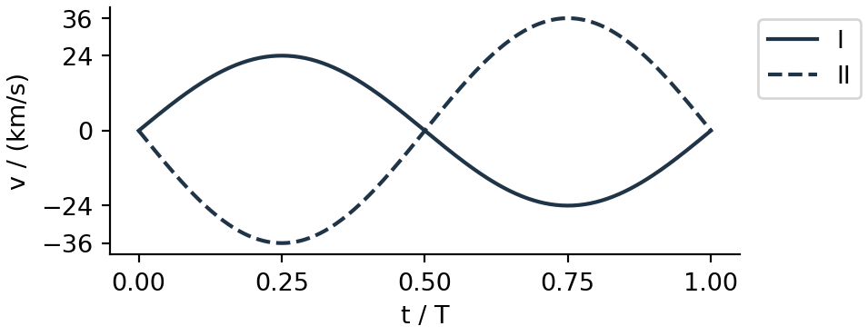
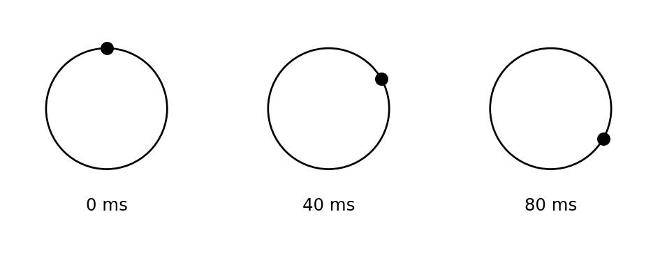
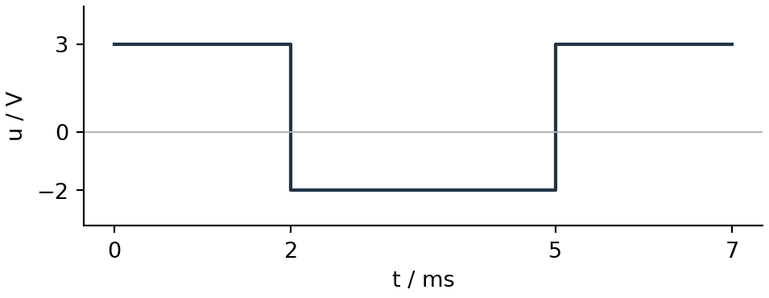
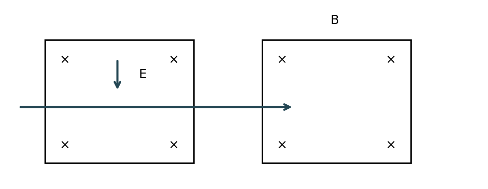

## 2 恒星视向运动
双星系统中两星视为质点，绕共同的圆心以相同角速度做圆周运动，外力忽略。观测方向平行于轨道平面。图中实线 I、虚线 II 所示两星相对系统质心的视向速度振幅分别为 24 km/s、36 km/s。I 星与 II 星的质量比、轨道半径比分别为

A. 2∶3，2∶3
B. 3∶2，3∶2
C. 3∶2，2∶3
D. 2∶3，3∶2

## 6 转速记录
匀速转轮上有一个标记，照相机每隔 0.040 s 曝光一次。从同一侧看，三次曝光的标记如图，每次都相对上一次沿顺时针转过表观角 60°。独立测量表明实际转向为逆时针、转速小于每秒 30 转。实际转速约为

A. 4.17 转/秒
B. 16.7 转/秒
C. 20.8 转/秒
D. 29.2 转/秒

## 7 感应与传感
铁芯上的检测线圈有 200 匝，另一个激励绕组通以周期性电流。忽略漏磁。检测线圈的开路电压如图，一个周期内先为 +3.0 V（持续 2.0 ms），再为 −2.0 V（持续 3.0 ms）。取 \(u=-N\,\mathrm d\Phi/\mathrm dt\)。若周期起点的每匝磁通量为 10 μWb，则

A. 每周期结束时磁通量减少 30 μWb
B. 磁通量最小值为 −20 μWb
C. 电压有效值为 2.55 V
D. 磁通量在第一个区间内保持恒定

## 9 速度选择器的偏差诊断
图中正离子向右进入速度选择器，电场向下、磁场垂直纸面向里。调至基准值 \(E_0,B_0\) 时，离子从中线水平穿过窄缝，进入另一垂直磁场形成谱线。若入射离子束很细，含有一小段连续的速率分布，可近似认为能通过狭缝的离子均在选择区沿直线运动。保持两区磁场不变，仅将选择区电场增大。下列判断正确的是

A. 原来沿中线穿过的同速正离子在选择区的初始偏转向下
B. 若只把电场方向反转，同一批向右运动的正离子仍能靠改变速率直线穿过
C. 同种离子的新谱线对应较小的回转半径
D. 只反转偏转区磁场，谱线换侧，同种离子回转半周的飞行时间不变

## 11 滚动影像实验
小组要检验桌面上滚动的小球在一段时间内是否做匀减速运动。一把刻度尺与球心轨迹处在同一平面，相机正对该平面。以等时间间隔 0.050 s 取五帧，球心位置依次为 0、4.8、9.2、13.2、16.8 cm。另一个小组用相同布置，却将标尺移到球心轨迹后面、更远离镜头的位置。
（1）由相邻两段位移之差检验模型，这些差均为 ________ cm（规定向前为正）。第三帧球心的瞬时速度为 ________ m/s。
（2）若另一组用画面中距离更远的标尺直接换算球心位移，所得加速度大小会 ________（填“偏大”或“偏小”）。为排除此误差，标尺应与 ________ 共面并平行于运动方向。

## 12 用滑线电桥定位电缆故障
检修台上两根等长同规格导线远端短接。长度均为 100 m，其中一根距近端 x 处碰壳，接触电阻忽略。把均匀电阻丝 A、B 两端分别接故障线与完好线的近端，电源接在碰壳点与滑动触头之间，电流计跨接 A、B。平衡时电流计指零，两条电缆到碰壳点的电阻比等于触头左右两段电阻丝的阻值比。电阻丝长 100.0 cm。
（1）检测时，触头位于 30.0 cm 刻度，电流计偏左；位于 35.0 cm 时偏右。为得到更精细读数，应在 ________ cm 至 ________ cm 之间移动触头，直至电流计 ________。
（2）平衡时左段长为 32.0 cm，沿故障线近端到碰壳点长 x，沿完好线近端绕远端到碰壳点长 ________（用 x 表示，单位 m）。故障点距离故障线近端 ________ m。
（3）若只在完好线近端额外串入一小段接线电阻，仍用上述理想长度关系反算，定位结果将 ________（填“偏大”或“偏小”）。
