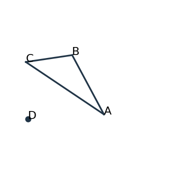

# fullA数学动态命题实验 · 研究审阅版

## 1.（5分）

复数分式运算中须同时注意分子与分母的模。
（1）计算下式的值。\(\left(\left|\frac{\left(1+i\right)}{\left(1-i\right)}\right|\right)^{2}\)。

A. \(0\)

B. \(2\)

C. \(1\)

D. \(\frac{1}{2}\)

## 2.（5分）

从编号1至6中选两个不同编号，至少一个不超过2。每组只计一次。
（1）求满足条件的有序结果数。各变量独立等可能取值，x∈\(\left\{1, 2, 3, 4, 5, 6\right\}\)，y∈\(\left\{1, 2, 3, 4, 5, 6\right\}\)。已知\(x< y\)。目标事件为\(x\leq 2\lor y\leq 2\)。

A. \(15\)

B. \(9\)

C. \(6\)

D. \(18\)

## 3.（5分）

两向量方向近乎垂直，求角度时须区别余弦与其平方。
（1）计算或判断向量性质。向量u=\(\left( 2, \  -1\right)\)，v=\(\left( 1, \  3\right)\)。求夹角余弦的平方。

A. \(\frac{1}{50}\)

B. \(\frac{1}{10}\)

C. \(0\)

D. \(\frac{1}{5}\)

## 4.（5分）

两次掷骰后得知点数不同，重新计算和为7的概率。
（1）在等可能样本中求条件概率。各变量独立等可能取值，x∈\(\left\{1, 2, 3, 4, 5, 6\right\}\)，y∈\(\left\{1, 2, 3, 4, 5, 6\right\}\)。已知\(x\ne y\)。目标事件为\(\left(x+y\right)= 7\)。

A. \(\frac{2}{5}\)

B. \(\frac{1}{6}\)

C. \(\frac{1}{3}\)

D. \(\frac{1}{5}\)

## 5.（5分）

利用区间位置限制三角函数和的可达范围。
（1）求最大值。\(\left(\sin\left(x\right)+\cos\left(x\right)\right)\)，x∈\(\left[\frac{\pi}{6}, \frac{\pi}{3}\right]\)。

A. \(\frac{1}{2} + \frac{\sqrt{3}}{2}\)

B. \(1\)

C. \(\sqrt{3}\)

D. \(\sqrt{2}\)

## 6.（5分）

圆与一条非过圆心直线相交。求两交点距离的平方。
（1）联立两曲线求指定交点量。两条曲线\(\left(\left(\left(x\cdot x\right)+\left(y\cdot y\right)\right)-5\right)\)=0，\(\left(\left(x+y\right)-1\right)\)=0。求两交点间距离的平方。

A. \(9\)

B. \(18\)

C. \(6\)

D. \(3 \sqrt{2}\)

## 7.（5分）

复合对数函数求导时，需要保留内层的变化率。
（1）求导数。\(\ln\left(\left(1+\left(x\cdot x\right)\right)\right)\)，指定值1，x∈\(\left(-\infty, \infty\right)\)。

A. \(1\)

B. \(0\)

C. \(\frac{1}{2}\)

D. \(2\)

## 8.（5分）

每个因子都可贡献0、1或2次幂，三次项有多条形成路径。
（1）求展开式指定幂的系数。\(\left(\left(\left(1+x\right)+\left(x\cdot x\right)\right)\right)^{4}\)，所求幂次3。

A. \(12\)

B. \(24\)

C. \(16\)

D. \(4\)

## 9.（6分）

已知数列aₙ=n(n+1)，判断下列关于正整数n的恒等命题。 选择所有正确命题。

A. 判断命题是否恒成立。\(\left(\left(\left(n+1\right)\cdot \left(n+2\right)\right)-\left(n\cdot \left(n+1\right)\right)\right)= \left(\left(2\cdot n\right)+2\right)\)。

B. 判断命题是否恒成立。\(\frac{\left(n+2\right)}{n}= 2\)。

C. 判断命题是否恒成立。\(\left(n\cdot \left(n+1\right)\right)= \left(n\cdot n\right)\)。

D. 判断命题是否恒成立。\(\frac{\left(n\cdot \left(n+1\right)\right)}{n}= \left(n+1\right)\)。

## 10.（6分）

判断关于函数及导数的四个命题。 选择所有正确命题。

A. 判断导数公式是否正确。函数\(\left(\left(x\right)^{3}-\left(3\cdot x\right)\right)\)，导数是否恒等于\(\left(\left(\left(3\cdot x\right)\cdot x\right)-3\right)\)？

B. 判断命题是否恒成立。\(\left(\left(1\right)^{3}-\left(3\cdot 1\right)\right)= 2\)。

C. 判断导数公式是否正确。函数\(\left(\left(x\right)^{3}-\left(3\cdot x\right)\right)\)，导数是否恒等于\(\left(\left(3\cdot x\right)\cdot x\right)\)？

D. 判断命题是否恒成立。\(\left(\left(-1\right)^{3}-\left(3\cdot -1\right)\right)= 2\)。

## 11.（6分）

判断空间向量关系。 选择所有正确命题。

A. 计算或判断向量性质。向量u=\(\left( 0, \  0, \  1\right)\)，v=\(\left( 1, \  1, \  0\right)\)。是否互相垂直。

B. 计算或判断向量性质。向量u=\(\left( 1, \  1, \  0\right)\)，v=\(\left( 1, \  -1, \  0\right)\)。是否互相垂直。

C. 计算或判断向量性质。向量u=\(\left( 1, \  1, \  0\right)\)，v=\(\left( 1, \  -1, \  0\right)\)。是否互相平行。

D. 计算或判断向量性质。向量u=\(\left( 0, \  0, \  1\right)\)，v=\(\left( 1, \  -1, \  0\right)\)。是否互相平行。

## 12.（5分）

这组数据关于均值成对分布，注意方差的分母。
（1）求样本统计量。样本数据[1, 2, 4, 5]，求方差。

## 13.（5分）

通项包含常数部分与衰减部分，求前五项和。
（1）求有限和。\(\sum_{k=1}^{5}\frac{\left(\left(3\right)^{k}-1\right)}{\left(3\right)^{\left(k-1\right)}}\)；n为正整数。

## 14.（5分）

将点与直线的相对位置化为距离。
（1）求几何量。求点\(\left( 2, \  3\right)\)到直线\(3 x - 4 y + 5\)=0的距离。

## 15.（13分）

两次独立从1至4等可能取整数，后续均使用同一组有序结果。
（1）在等可能样本中求条件概率。各变量独立等可能取值，x∈\(\left\{1, 2, 3, 4\right\}\)，y∈\(\left\{1, 2, 3, 4\right\}\)。已知\(x\ne y\)。目标事件为\(\left(x+y\right)\geq 6\)。
（2）在等可能样本中求条件概率。各变量独立等可能取值，x∈\(\left\{1, 2, 3, 4\right\}\)，y∈\(\left\{1, 2, 3, 4\right\}\)。已知\(x\ne y\land \left(x+y\right)\geq 6\)。目标事件为\(x= 4\)。
（3）求条件期望。各变量独立等可能取值，x∈\(\left\{1, 2, 3, 4\right\}\)，y∈\(\left\{1, 2, 3, 4\right\}\)。已知\(x\ne y\)。随机变量为\(x + y\)。

## 16.（15分）

三点确定斜置平面，再研究原点与一条指定方向直线。
（1）求几何量。平面由三点A=\(\left( 2, \  0, \  1\right)\)，B=\(\left( 0, \  2, \  1\right)\)，C=\(\left( 0, \  0, \  2\right)\)确定。求点D=\(\left( 0, \  0, \  0\right)\)到该平面的距离。
（2）求几何量。平面由三点A=\(\left( 2, \  0, \  1\right)\)，B=\(\left( 0, \  2, \  1\right)\)，C=\(\left( 0, \  0, \  2\right)\)确定。求方向向量为\(\left( 1, \  0, \  1\right)\)的直线与该平面夹角的正弦。

## 17.（15分）

一次驱动项带项号的递推，可用变换消去非齐次部分。
（1）求数列通项。\(\left(\left(u\left(\left(n+1\right)\right)-\left(2\cdot u\left(n\right)\right)\right)-n\right)\)=0，初值u(1)=1，n为正整数。
（2）求递推数列的加权和。\(\left(\left(u\left(\left(n+1\right)\right)-\left(2\cdot u\left(n\right)\right)\right)-n\right)\)=0，初值u(1)=1，n为正整数。求\(\sum_{k=1}^{n} 2^{- k} u{\left(k \right)}\)。

## 18.（17分）

先确定椭圆半轴，再研究椭圆点到固定点的距离平方。
椭圆\(x^2/4+y^2=1\)，点\(P=(2\cos t,\sin t)\)，固定点\(D=(0,2)\)。点P遍历整条椭圆，令\(u=\sin t\)，故\(u\in[-1,1]\)且取遍。
（1）解方程组。\(\left(\left(\left(a\cdot a\right)-\left(b\cdot b\right)\right)-3\right)\)=0，\(\left(\left(a+b\right)-3\right)\)=0, 未知量a,b为实数。附加限制\(a> b\),\(b> 0\)。
（2）判断并证明恒等式。\(\left(\sin{\left(t \right)} - 2\right)^{2} + 4 \cos^{2}{\left(t \right)}\)=\(- 3 \sin^{2}{\left(t \right)} - 4 \sin{\left(t \right)} + 8\)。
（3）x表示u，求距离平方的最值及取到的位置。\(\left(\left(8-\left(\left(3\cdot x\right)\cdot x\right)\right)-\left(4\cdot x\right)\right)\)，x∈\(\left[-1, 1\right]\)。

## 19.（17分）

参数的临界值与导数的零点重数共同影响单调性。
（1）求使函数在定义域内单调不减的参数范围。\(\left(\left(\frac{\left(x\right)^{3}}{3}-\left(\left(2\cdot x\right)\cdot x\right)\right)+\left(a\cdot x\right)\right)\)，x∈\(\left[0, 3\right]\)，参数a为实数。
（2）求单调增减区间与驻点。\(\left(\left(\frac{\left(x\right)^{3}}{3}-\left(\left(2\cdot x\right)\cdot x\right)\right)+\left(3\cdot x\right)\right)\)，x∈\(\left[0, 3\right]\)。
（3）证明下式非负并讨论取等。\(\left(\left(\frac{\left(x\right)^{3}}{3}-\left(\left(2\cdot x\right)\cdot x\right)\right)+\left(4\cdot x\right)\right)\)，x∈\(\left[0, \infty\right)\)。

