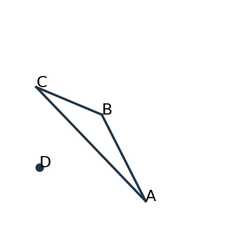

# fullB数学动态命题实验 · 研究审阅版

## 1.（5分）

集合由实方程的解组成，选出其中落在(0,1)内的唯一元素。
（1）在给定定义域内求方程的全部解。\(\left(\left(\left(x\cdot x\right)+\left(2\cdot x\right)\right)-2\right)\)=0，x∈\(\left(0, 1\right)\)。

A. \(-1 + \sqrt{2}\)

B. \(\frac{1}{2}\)

C. \(-1 + \sqrt{3}\)

D. \(2 - \sqrt{3}\)

## 2.（5分）

求使一个复数乘积成为实数的实参数。
（1）在给定定义域内求方程的全部解。\(\operatorname{Im}\left(\left(\left(x+i\right)\cdot \left(2-i\right)\right)\right)\)=0。

A. \(2\)

B. \(-2\)

C. \(\frac{1}{2}\)

D. \(1\)

## 3.（5分）

样本有偶数个观测，注意中间两个数。
（1）求样本统计量。样本数据[2, 5, 5, 8, 11, 12]，求中位数。

A. \(8\)

B. \(5\)

C. \(9\)

D. \(\frac{13}{2}\)

## 4.（5分）

把两个特殊角函数的乘积转化为二倍角。
（1）计算下式的值。\(\left(\sin\left(\frac{\pi}{12}\right)\cdot \cos\left(\frac{\pi}{12}\right)\right)\)。

A. \(\frac{1}{2}\)

B. \(- \frac{1}{4} + \frac{\sqrt{3}}{4}\)

C. \(\frac{1}{4}\)

D. \(\frac{\sqrt{3}}{4}\)

## 5.（5分）

水平直线与椭圆的交点个数需要按实际条件判定。
（1）联立两曲线求指定交点量。两条曲线\(\left(\left(\frac{\left(x\cdot x\right)}{9}+\frac{\left(y\cdot y\right)}{4}\right)-1\right)\)=0，\(\left(y-2\right)\)=0。求不同实交点数。

A. \(1\)

B. \(2\)

C. \(4\)

D. \(0\)

## 6.（5分）

两次掷骰，已知至少一次为6，求两次点数均为偶数的概率。
（1）在等可能样本中求条件概率。各变量独立等可能取值，x∈\(\left\{1, 2, 3, 4, 5, 6\right\}\)，y∈\(\left\{1, 2, 3, 4, 5, 6\right\}\)。已知\(x= 6\lor y= 6\)。目标事件为\(\left(x\bmod 2\right)= 0\land \left(y\bmod 2\right)= 0\)。

A. \(\frac{6}{11}\)

B. \(\frac{1}{4}\)

C. \(\frac{3}{11}\)

D. \(\frac{5}{11}\)

## 7.（5分）

奇数相邻比的有限积会留下一个末端因子。
（1）求有限积。\(\prod_{k=1}^{4}\frac{\left(\left(2\cdot k\right)-1\right)}{\left(\left(2\cdot k\right)+1\right)}\)；n为正整数。

A. \(\frac{1}{5}\)

B. \(\frac{1}{9}\)

C. \(\frac{1}{7}\)

D. \(\frac{1}{3}\)

## 8.（5分）

商函数在原点的导数不能由分子或分母单独决定。
（1）求导数。\(\frac{x}{\left(1+\left(x\cdot x\right)\right)}\)，指定值0。

A. \(-1\)

B. \(1\)

C. \(2\)

D. \(0\)

## 9.（6分）

x、y是正交单位基下的两个实坐标，判断下列恒真命题。 选择所有正确命题。

A. 判断命题是否恒成立。\(\left(\left(x+y\right)\right)^{2}= \left(\left(x\cdot x\right)+\left(y\cdot y\right)\right)\)。

B. 判断命题是否恒成立。\(\left(\left(x-y\right)\right)^{2}\geq 0\)。

C. 判断命题是否恒成立。\(\left(\left(\left(x+y\right)\right)^{2}+\left(\left(x-y\right)\right)^{2}\right)= \left(2\cdot \left(\left(x\cdot x\right)+\left(y\cdot y\right)\right)\right)\)。

D. 判断命题是否恒成立。\(\left(x\cdot y\right)= \left(y\cdot y\right)\)。

## 10.（6分）

逐个判断点是否位于同一椭圆上。 选择所有正确命题。

A. 判断点是否属于曲线。点\(\left( 3, \  0\right)\)是否属于曲线\(\frac{x^{2}}{9} + \frac{y^{2}}{4} - 1\)=0？

B. 判断点是否属于曲线。点\(\left( 1, \  1\right)\)是否属于曲线\(\frac{x^{2}}{9} + \frac{y^{2}}{4} - 1\)=0？

C. 判断点是否属于曲线。点\(\left( 0, \  2\right)\)是否属于曲线\(\frac{x^{2}}{9} + \frac{y^{2}}{4} - 1\)=0？

D. 判断点是否属于曲线。点\(\left( 3, \  2\right)\)是否属于曲线\(\frac{x^{2}}{9} + \frac{y^{2}}{4} - 1\)=0？

## 11.（6分）

两个公平的0-1记录相互独立，判断条件改变后的概率命题。 选择所有正确命题。

A. 判断给定概率是否正确。各变量独立等可能取值，x∈\(\left\{0, 1\right\}\)，y∈\(\left\{0, 1\right\}\)。已知\(\left(x+y\right)= 1\)。目标事件为\(x= 1\)。概率是否等于\(\frac{1}{2}\)？

B. 判断给定概率是否正确。各变量独立等可能取值，x∈\(\left\{0, 1\right\}\)，y∈\(\left\{0, 1\right\}\)。目标事件为\(\left(x+y\right)= 2\)。概率是否等于\(\frac{1}{2}\)？

C. 判断给定概率是否正确。各变量独立等可能取值，x∈\(\left\{0, 1\right\}\)，y∈\(\left\{0, 1\right\}\)。目标事件为\(\left(x+y\right)= 1\)。概率是否等于\(\frac{1}{2}\)？

D. 判断给定概率是否正确。各变量独立等可能取值，x∈\(\left\{0, 1\right\}\)，y∈\(\left\{0, 1\right\}\)。已知\(y= 1\)。目标事件为\(x= 1\)。概率是否等于\(1\)？

## 12.（5分）

三个0-1位置中恰好两个为1。
（1）求满足条件的有序结果数。各变量独立等可能取值，x∈\(\left\{0, 1\right\}\)，y∈\(\left\{0, 1\right\}\)，t∈\(\left\{0, 1\right\}\)。目标事件为\(\left(\left(x+y\right)+t\right)= 2\)。

## 13.（5分）

两个变化因子的导数均可能产生贡献。
（1）求导数。\(\left(\left(\left(x\cdot x\right)+1\right)\cdot \ln\left(x\right)\right)\)，指定值1，x∈\(\left(0, \infty\right)\)。

## 14.（5分）

三维向量张成一个三角形，面积与平行四边形面积不同。
（1）计算或判断向量性质。向量u=\(\left( 1, \  1, \  0\right)\)，v=\(\left( 0, \  1, \  1\right)\)。求这两个向量张成的三角形面积的平方。

## 15.（13分）

同一组相位平移可产生不变量与变化的线性和。
（1）判断并证明恒等式。\(\sin^{2}{\left(x + \frac{\pi}{4} \right)} + \cos^{2}{\left(x + \frac{\pi}{4} \right)}\)=\(1\)。
（2）求最小值、最大值及取到的位置。\(\left(\sin\left(\left(x+\frac{\pi}{4}\right)\right)+\sin\left(\left(x-\frac{\pi}{4}\right)\right)\right)\)，x∈\(\left[0, \pi\right]\)。

## 16.（15分）

从1至5中取三个互异编号，以递增顺序记为x、y、t。
（1）在等可能样本中求条件概率。各变量独立等可能取值，x∈\(\left\{1, 2, 3, 4, 5\right\}\)，y∈\(\left\{1, 2, 3, 4, 5\right\}\)，t∈\(\left\{1, 2, 3, 4, 5\right\}\)。已知\(x< y\land y< t\)。目标事件为\(\left(\left(\left(x+y\right)+t\right)\bmod 2\right)= 0\)。
（2）在等可能样本中求条件概率。各变量独立等可能取值，x∈\(\left\{1, 2, 3, 4, 5\right\}\)，y∈\(\left\{1, 2, 3, 4, 5\right\}\)，t∈\(\left\{1, 2, 3, 4, 5\right\}\)。已知\(x< y\land y< t\land t= 5\)。目标事件为\(\left(\left(\left(x+y\right)+t\right)\bmod 2\right)= 0\)。
（3）求条件期望。各变量独立等可能取值，x∈\(\left\{1, 2, 3, 4, 5\right\}\)，y∈\(\left\{1, 2, 3, 4, 5\right\}\)，t∈\(\left\{1, 2, 3, 4, 5\right\}\)。已知\(x< y\land y< t\)。随机变量为\(x y\)。

## 17.（15分）

相邻两项之和是平方，奇偶部分会发生不同的抵消。
（1）求数列通项。\(\left(\left(u\left(\left(n+1\right)\right)+u\left(n\right)\right)-\left(n\cdot n\right)\right)\)=0，初值u(1)=1，n为正整数。
（2）求递推数列的加权和。\(\left(\left(u\left(\left(n+1\right)\right)+u\left(n\right)\right)-\left(n\cdot n\right)\right)\)=0，初值u(1)=1，n为正整数。求\(\sum_{k=1}^{2 n} u{\left(k \right)}\)。

## 18.（17分）

平面由三个轴截点确定，动点到平面的距离可转化为一元式。
（1）求几何量。平面由三点A=\(\left( 3, \  0, \  0\right)\)，B=\(\left( 0, \  3, \  0\right)\)，C=\(\left( 0, \  0, \  3\right)\)确定。求点D=\(\left( 0, \  0, \  0\right)\)到该平面的距离。
（2）动点P=(t,1-t,t²)到该平面距离的平方如下，求其最值及位置。\(\frac{\left(\left(\left(t\cdot t\right)-2\right)\right)^{2}}{3}\)，t∈\(\left[-2, 2\right]\)。
（3）求动点落入该平面的全部参数。\(\left(\left(t\cdot t\right)-2\right)\)=0，t∈\(\left[-2, 2\right]\)。

## 19.（17分）

对数参数函数的区间条件与全域切线界需分别讨论。
（1）求使函数在定义域内单调不减的参数范围。\(\left(\ln\left(x\right)-\left(\left(a\cdot x\right)\cdot x\right)\right)\)，x∈\(\left[1, 2\right]\)，参数a为实数。
（2）证明下式非负并讨论取等。\(\left(\left(\ln\left(x\right)-1\right)+\frac{1}{x}\right)\)，x∈\(\left(0, \infty\right)\)。

