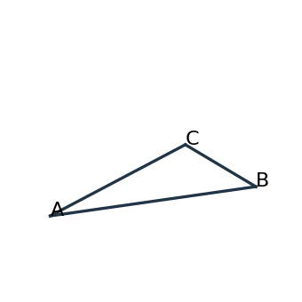

# mixed50数学动态命题实验 · 研究审阅版

## 1.（5分）

单位虚数的幂运算需要处理周期与系数。
（1）计算下式的值。\(\left(\left(1+i\right)\right)^{4}\)。

A. \(2\)

B. \(4\)

C. \(-4\)

D. \(-2\)

## 2.（5分）

从1至6中等可能取数，已知取数大于2，求其为3或5的概率。
（1）在等可能样本中求条件概率。各变量独立等可能取值，x∈\(\left\{1, 2, 3, 4, 5, 6\right\}\)。已知\(x> 2\)。目标事件为\(x= 3\lor x= 5\)。

A. \(\frac{1}{2}\)

B. \(\frac{1}{3}\)

C. \(\frac{2}{3}\)

D. \(\frac{1}{4}\)

## 3.（5分）

特殊角的函数值与互余关系共同简化。
（1）计算下式的值。\(\left(\sin\left(\frac{\pi}{6}\right)+\cos\left(\frac{\pi}{3}\right)\right)\)。

A. \(\frac{1}{2}\)

B. \(\sqrt{3}\)

C. \(\frac{\sqrt{3}}{2}\)

D. \(1\)

## 4.（5分）

求相邻幂之差的有限和，尤其注意第一项。
（1）求有限和。\(\sum_{k=1}^{6}\left(\left(2\right)^{k}-\left(2\right)^{\left(k-1\right)}\right)\)；n为正整数。

A. \(32\)

B. \(63\)

C. \(64\)

D. \(31\)

## 5.（10分）

既检查给定函数的端点，也研究另一参数函数的单调范围。
（1）求最小值、最大值及取到的位置。\(\frac{x}{\left(1+x\right)}\)，x∈\(\left[0, 3\right]\)。
（2）求使函数在定义域内单调不减的参数范围。\(\left(\frac{\left(x\cdot x\right)}{2}+\left(a\cdot x\right)\right)\)，x∈\(\left[-1, 2\right]\)，参数a为实数。

## 6.（10分）

用两个非共线向量确定过原点的平面，联系面积与线面角。
（1）计算或判断向量性质。向量u=\(\left( 1, \  1, \  0\right)\)，v=\(\left( 1, \  0, \  1\right)\)。求这两个向量张成的平行四边形面积的平方。
（2）求几何量。平面由三点A=\(\left( 0, \  0, \  0\right)\)，B=\(\left( 1, \  1, \  0\right)\)，C=\(\left( 1, \  0, \  1\right)\)确定。求方向向量为\(\left( 1, \  1, \  1\right)\)的直线与该平面夹角的正弦。

## 7.（10分）

过原点的斜线截椭圆所得弦也经过椭圆中心。
（1）联立两曲线求指定交点量。两条曲线\(\left(\left(\frac{\left(x\cdot x\right)}{4}+\left(y\cdot y\right)\right)-1\right)\)=0，\(\left(y-\frac{x}{2}\right)\)=0。求不同实交点数。
（2）联立两曲线求指定交点量。两条曲线\(\left(\left(\frac{\left(x\cdot x\right)}{4}+\left(y\cdot y\right)\right)-1\right)\)=0，\(\left(y-\frac{x}{2}\right)\)=0。求两交点间距离的平方。

