# 2027 河南新高考化学标准模拟卷

满分100分，考试时间75分钟。

## 一、单项选择题

本大题共14小题，每小题3分，共42分。在每小题给出的四个选项中，只有一项是符合题目要求的。

## 1.（3分）

钢渣的低碳回收利用包括以水玻璃为黏结剂制备建筑材料。用含二氧化碳的气体养护后，发现部分游离氧化钙已转化为碳酸钙，同时出现硅胶。下列对该处理过程的解释正确的是
A．固碳过程使碳元素由高价转化为低价
B．水玻璃中的硅酸盐硬化时仅发生水分蒸发
C．钢渣中氧化钙转化为碳酸钙时钙元素的价态升高
D．部分气态二氧化碳在养护过程中转化为固态碳酸盐中的碳

## 2.（3分）

密闭容器中有 \(0.400\,\mathrm{mol}\) 氧气，仅含 \({}^{18}\mathrm{O}_2\) 和 \({}^{16}\mathrm{O}_2\)，两者的分子数之比为 \(1:3\)。设 \(N_{\mathrm A}\) 为阿伏加德罗常数的值。下列说法正确的是
A．\({}^{18}\mathrm O_2\) 的分子数为 \(0.200N_{\mathrm A}\)
B．\({}^{18}\mathrm O\) 的原子数为 \(0.200N_{\mathrm A}\)
C．\({}^{16}\mathrm O\) 的原子数为 \(0.300N_{\mathrm A}\)
D．全部氧原子中的质子数为 \(3.20N_{\mathrm A}\)

## 3.（3分）

小量乙醇与乙酸的酯化实验装置如图，竖直冷凝管上端敞开。下列关于冷却水和加热的实验操作正确的是
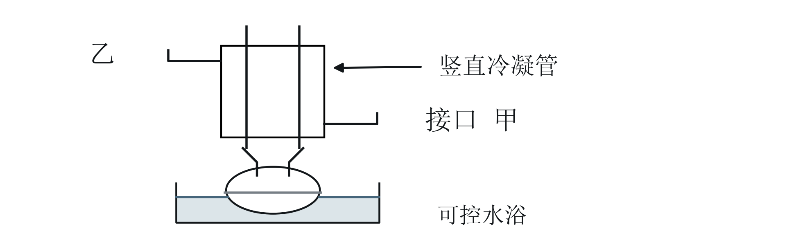
A．由甲进、乙出；水浴加热
B．由乙进、甲出；水浴加热
C．由甲进、乙出；加热前封闭冷凝管上端
D．由甲进、乙出；待烧瓶内液体沸腾后再通冷却水

## 4.（3分）

柴油车尾气净化中，尿素水解生成 \(\mathrm{NH_3}\) 和 \(\mathrm{CO_2}\)。当尾气中氮氧化物主要为 \(\mathrm{NO}\) 时，净化反应为 \(4\mathrm{NH_3}+4\mathrm{NO}+\mathrm{O_2}\longrightarrow4\mathrm{N_2}+6\mathrm{H_2O}\)。下列说法正确的是
A．尿素水解时碳元素发生了氧化
B．净化时每消耗 \(1\,\mathrm{mol}\ \mathrm{NO}\)，共有 \(2\,\mathrm{mol}\) 电子转移
C．\(1\,\mathrm{mol}\) 尿素完全水解形成的氨，按该反应可恰好净化 \(2\,\mathrm{mol}\ \mathrm{NO}\)
D．\(\mathrm{NO}\) 和 \(\mathrm{O_2}\) 在该反应中分别充当氧化剂和还原剂

## 5.（3分）

硼酸溶液中发生反应 \(\mathrm{B(OH)_3}+2\mathrm{H_2O}\rightleftharpoons[\mathrm{B(OH)_4}]^-+\mathrm{H_3O}^+\)。图中仅标出含硼微粒的 B 和 O。结合图中的成键方向和价层电子对互斥模型，下列说法正确的是
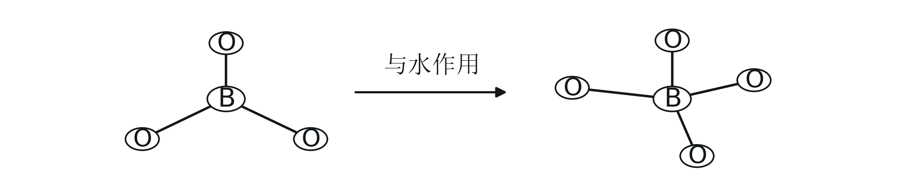
A．两种含硼微粒中硼中心的构型相同
B．新增 B—O 键所用电子对由硼原子提供
C．水与 \(\mathrm{B(OH)_3}\) 作用时硼的氧化数由 +3 变为 +4
D．反应后四个氧原子可占据近似四面体的四个顶点

## 6.（3分）

在两只相同量热器中，将 \(50.0\,\mathrm{mL}\ 0.500\,\mathrm{mol/L}\ \mathrm{NaOH}\) 溶液分别与等体积、等浓度的盐酸和醋酸溶液混合。所有溶液初温相同，两组测得温升依次为 \(3.4^\circ\mathrm{C}\) 与 \(3.0^\circ\mathrm{C}\)。忽略散热及稀释效应，每组体系总热容均为 \(4.18\times10^2\,\mathrm{J/K}\)。醋酸电离焓的实验估计值约为
A．\(+6.7\,\mathrm{kJ/mol}\)
B．\(-6.7\,\mathrm{kJ/mol}\)
C．\(+3.3\,\mathrm{kJ/mol}\)
D．\(+50\,\mathrm{kJ/mol}\)

## 7.（3分）

芳樟醇是某些植物精油的成分，结构如图。不考虑碳碳双键的立体异构，下列说法正确的是
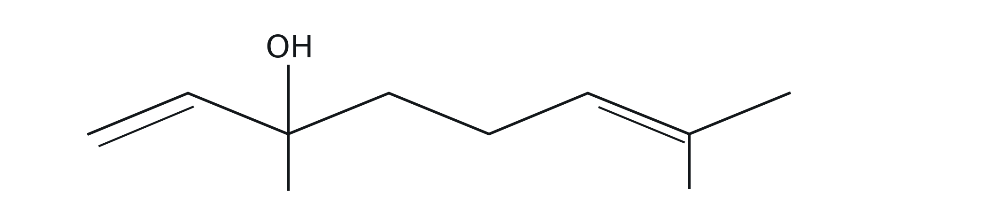
A．与 \(\mathrm{H_2}\) 完全加成时，\(1\,\mathrm{mol}\) 芳樟醇最多与 \(1\,\mathrm{mol}\ \mathrm{H_2}\) 反应
B．芳樟醇分子式为 \(\mathrm{C_{10}H_{20}O}\)
C．羟基所连碳原子为手性碳原子
D．羟基所连碳原子为伯碳原子

## 8.（3分）

甲、乙为中性含铂配合物，平面结构如图。“氯”指 \(\mathrm{Cl}^-\)，“氨”指 \(\mathrm{NH_3}\)。中性配体 L 只可同时占据两个相邻的氯位点，置换时氯以 \(\mathrm{Cl}^-\) 离去，氨不被置换。取甲和乙共 \(0.060\,\mathrm{mol}\)，使能发生的置换完全进行，检出游离 \(\mathrm{Cl}^-\) 共 \(0.040\,\mathrm{mol}\)。不发生构型互变或铂价态变化。下列说法正确的是
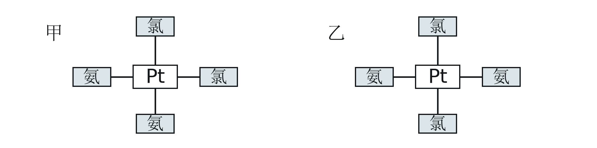
A．生成的配离子带两个单位正电荷，甲占原混合物的 2/3
B．生成的配离子带两个单位正电荷，甲占原混合物的 1/3
C．只有乙可发生该置换，产物配离子带两个单位正电荷
D．甲占原混合物的 1/3，生成的含铂配合物仍为中性

## 9.（3分）

未处理金红石晶体的四方晶胞如图，全部粒子位于下底面 \(z=0\)、中间截面 \(z=1/2\) 或上底面 \(z=1\)，上、下底面分布相同。经温和还原后有部分氧原子从原有氧位点移出，原有位点总数与钛原子数不变。若只考虑氧位点的空缺和 \(\mathrm{Ti^{4+}}\) 还原为 \(\mathrm{Ti^{3+}}\)，测得处理后钛元素中 20% 为 \(\mathrm{Ti^{3+}}\)。处理后每晶胞的平均氧空位数和原有氧位点仍被氧占据的比例分别为
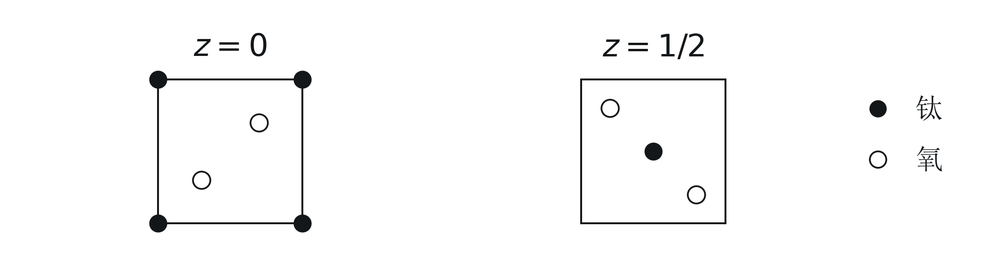
A．0.10，97.5%
B．0.40，90%
C．0.20，95%
D．0.20，90%

## 10.（3分）

某催化表面上，同一反应物先生成中间体，中间体再沿图示两条路径生成产物甲、乙。假定各基元反应的指前因子相同，只比较中间体已生成后的初始分支速率。下列说法正确的是
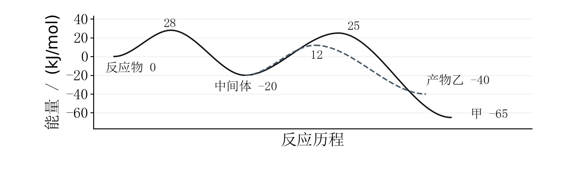
A．甲路径放热更多，中间体优先生成甲
B．甲分支的正向能垒为 25 kJ/mol
C．由产物甲回到中间体的能垒为 45 kJ/mol
D．相同温度下乙分支初始速率较大，但反应物转化为甲时放热较多

## 11.（3分）

己内酯开环聚合制得可用作缓释材料的聚己内酯，单体及理想链节如图。忽略高分子的端基差异，下列说法正确的是
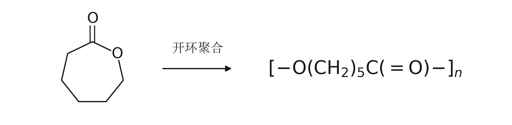
A．聚己内酯的酯键位于主链上，彻底水解可得到 6-羟基己酸
B．每接入 1 mol 己内酯，链增长同时放出 1 mol 水
C．以溴水检验链节中碳碳双键，可由溴水明显褪色判断聚合程度
D．链节彻底水解后，得到含两个独立羧基的化合物

## 12.（3分）

图示装置以醋酸钠水溶液为原料。阴、阳离子膜各只允许相应离子通过，阴离子膜仅转移 \(\mathrm{CH_3COO^-}\)，阳离子膜仅转移 \(\mathrm{Na^+}\)。双极膜（BPM）内的水解离为 \(\mathrm H^+\) 和 \(\mathrm{OH^-}\)，两者在膜两侧分开。箭头表示进入工作室的离子运动方向，酸、碱室以纯水启动。忽略副反应及膜渗漏。通电量为 \(1\,\mathrm{mol}\) 电子所带电量时，下列说法正确的是
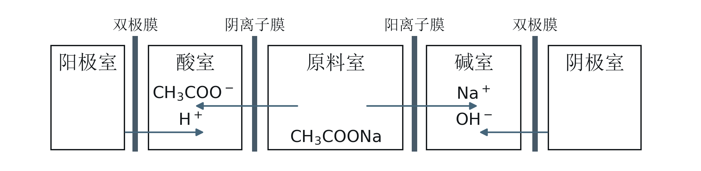
A．原料室移去的阴离子进入碱室，移去的阳离子进入酸室
B．酸室形成约 1 mol 醋酸，碱室增加约 1 mol 氢氧化钠
C．两个双极膜合计消耗 1 mol 水
D．阴极反应生成的氢氧根是碱室内氢氧根的主要来源

## 13.（3分）

研究底物降解，恒温下改变初始浓度，得到图示关系。实线组的总初速率是图中虚线所示未催化路径与催化路径的初速率之和。现向实线组加入一种抑制剂，只使催化路径的初速率减半。初始浓度取 1、2、3、4 mmol/L 四个图示值之一。下列说法正确的是
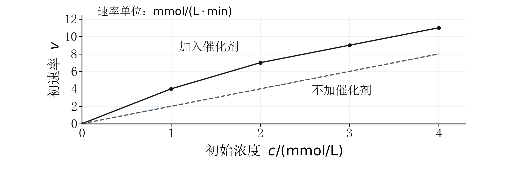
A．在四个给定浓度处，催化路径的初速率均随浓度增大而增大
B．浓度为 4 mmol/L 时，加抑制剂后总初速率为 5.5 mmol/(L·min)
C．加抑制剂后，总初速率达到 7.5 mmol/(L·min) 所需的最小给定浓度为 3 mmol/L
D．浓度由 2 增至 3 mmol/L 时，加抑制剂的组总初速率增加 1.0 mmol/(L·min)

## 14.（3分）

一元弱酸型指示剂 HIn 的 \(\mathrm{p}K_a=7.10\)，阴离子为 \(\mathrm{In^-}\)。同一总浓度和光程下，纯酸式和纯碱式在两波长的吸光度如图；混合时，各波长的吸光度为两种形态按物质的量分数乘以对应吸光度后相加。若某样品两波长的吸光度相等，则其 pH 约为（\(\lg 2=0.30\)）
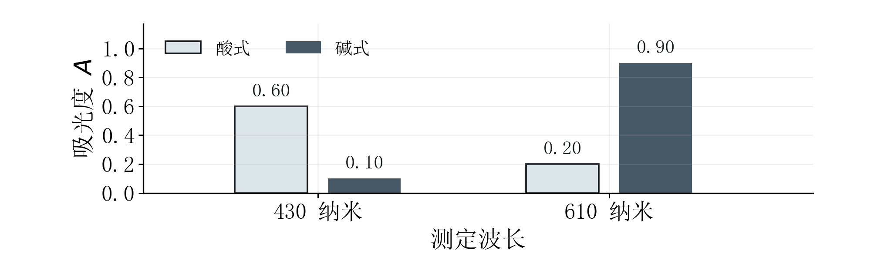
A．6.80
B．7.10
C．7.40
D．6.62

## 二、非选择题

本大题共4小题，共58分。按题意填写或作答。计算题须写出必要的文字说明、方程式和演算步骤。

## 15.（14分）

某镀锌厂回收含锌废料。经硫酸浸出后，液相主要含 \(\mathrm{Zn^{2+}}\)，少量含 \(\mathrm{Fe^{2+}}\)、\(\mathrm{Cu^{2+}}\)。部分流程和同一进料下的除铁试验如图。试验在加入足量 \(\mathrm{H_2O_2}\) 完成氧化后进行，表中铁、锌的百分数分别以它们进入该步骤的总量为基准。
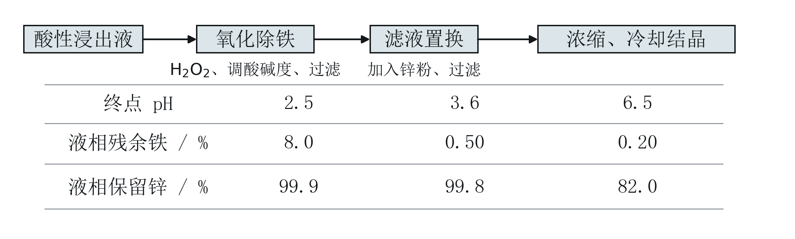
（1） 氧化步骤的离子方程式为①________________________________________________。若进料含 \(0.120\,\mathrm{mol}\ \mathrm{Fe^{2+}}\)，理论上至少需加入②________ mol 过氧化氢。
（2） 要求滤液中铁残余不大于进料铁的 0.50%，锌保留不低于进料锌的 99.0%。在图示三种方案中，应将 pH 调至③________。此条件下铁主要以氢氧化物形式除去，其化学式为④________。
（3） 滤液加锌粉除铜，反应的离子方程式为⑤____________________________________。除铁后若再补入过量硫酸，会增加锌粉消耗，其原因为⑥____________________________________。
（4） 除铜后得 \(2.00\,\mathrm L\) 溶液。取 \(10.00\,\mathrm{mL}\)，用 \(0.0500\,\mathrm{mol/L}\) EDTA 滴定耗去 \(18.00\,\mathrm{mL}\)，仅锌与 EDTA 以 1∶1 络合。若 90.0% 的锌析出为 \(\mathrm{ZnSO_4\cdot7H_2O}\)（\(M=287.5\,\mathrm{g/mol}\)），可得晶体⑦________ g。结果保留三位有效数字。

## 16.（14分）

取 \(1.000\,\mathrm g\) 填料样品，测其碳酸钙质量分数。样品中其余成分遇稀盐酸不产气。按图充分反应，生成的 \(\mathrm{CO_2}\) 由含 \(0.0400\,\mathrm{mol}\ \mathrm{NaOH}\) 的吸收液完全吸收，吸收后仍有游离碱。密闭转移全部吸收液，用 \(1.000\,\mathrm{mol/L}\) 盐酸滴定。酚酞终点时恰好将 \(\mathrm{OH^-}\) 中和、\(\mathrm{CO_3^{2-}}\) 转化为 \(\mathrm{HCO_3^-}\)。随后换指示剂滴至 \(\mathrm{HCO_3^-}\) 恰好耗尽。
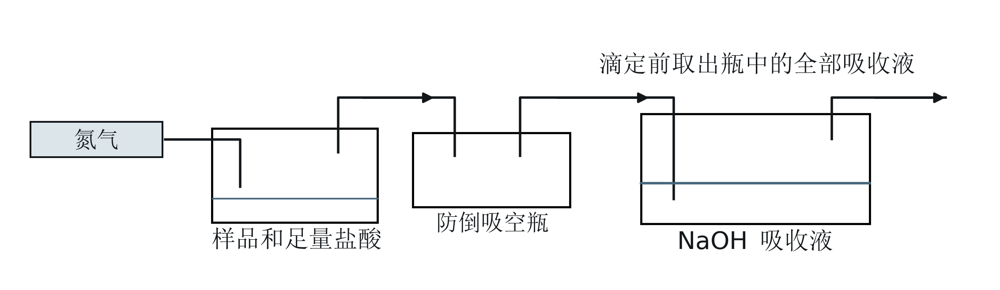
（1） 通入不含二氧化碳的氮气，反应前赶走原有空气，反应后继续通气的主要作用为①____________________________________。滴定时用于准确测量盐酸标准液用量的玻璃仪器是②________________。
（2） 预试中将反应液过滤，所得残渣加酸未再见气泡。正式测定时，滴定至酚酞终点，溶液由浅红色变为③________。首次共耗盐酸 \(32.00\,\mathrm{mL}\)，到第二终点又耗用盐酸 \(8.00\,\mathrm{mL}\)。第二阶段的主要离子反应为④____________________________________________。
（3） 吸收的 \(\mathrm{CO_2}\) 为⑤________ mol。以 \(M(\mathrm{CaCO_3})=100.0\,\mathrm{g/mol}\) 计算，填料中碳酸钙质量分数为⑥________。
（4） 若反应后过早停止通氮气，确认部分生成的 \(\mathrm{CO_2}\) 滞留在反应瓶中，则所测填料中碳酸钙质量分数⑦________（填“偏高”或“偏低”），其原因为⑧________________________。

## 17.（15分）

研究二氧化碳消耗氢气对乙烷脱氢的影响。教学模型中只考虑下列反应。反应Ⅰ：\(\mathrm{C_2H_6(g)}\rightleftharpoons\mathrm{C_2H_4(g)}+\mathrm{H_2(g)}\)，\(\Delta H_1=+137\,\mathrm{kJ/mol}\)。反应Ⅱ：\(\mathrm{CO_2(g)}+\mathrm{H_2(g)}\rightleftharpoons\mathrm{CO(g)}+\mathrm{H_2O(g)}\)，\(\Delta H_2=+41\,\mathrm{kJ/mol}\)。恒温及总压 \(200\,\mathrm{kPa}\) 下，开始时气相含 \(1.00\,\mathrm{mol}\) 乙烷、\(1.40\,\mathrm{mol}\) 二氧化碳。随时间变化的乙烯和水蒸气数据如图，两条曲线平台对应平衡。
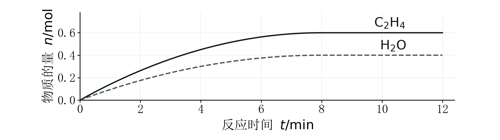
（1） 将反应Ⅰ和Ⅱ叠加，得到的总反应为①________（填“吸热”或“放热”）反应，其反应焓为②________ kJ/mol（写出符号）。
（2） 平衡时，气相中剩余乙烷为③________ mol，氢气为④________ mol。
（3） 平衡时乙烯的分压为⑤________ kPa。取标准压力 \(p^\circ=100\,\mathrm{kPa}\)，以 \(p/p^\circ\) 表示气体活度，则反应Ⅰ、Ⅱ的平衡常数依次为⑥________、⑦________。
（4） 恒温瞬时压缩体系后，只判断气体组成尚未改变的起始瞬间。反应Ⅰ的净反应方向为⑧________，反应Ⅱ的净反应方向为⑨________（填“正向”“逆向”或“无净反应”）。
（5） 另从图示平衡出发，在恒温恒容下选择性移走少量 CO。解释 CO 的减少如何推动乙烯生成：⑩________________________________________________________________________。

## 18.（15分）

由苯乙酮制备一种芳香酯 G，流程如图（m– 表示两个取代基处于苯环间位）。步骤 1 为一硝化，步骤 2 选择性将硝基还原为氨基，步骤 4 使酚羟基发生 O-甲基化，步骤 5 只将芳香酮羰基还原，步骤 6 以乙酸酐将醇羟基酰化。已知：① 苯环上的乙酰基 \(-\mathrm{COCH_3}\) 使新引入的硝基主要进入间位；② 在适当条件下，可使 \(\mathrm{ArNH_2}\longrightarrow\mathrm{ArN_2^+}\longrightarrow\mathrm{ArOH}\)（Ar 表示芳基），原有的酮羰基保持不变；③ 可用 \(\mathrm{CH_3I}\) 与碳酸钾进行酚羟基的 O-甲基化，可用 \(\mathrm{NaBH_4}\) 使醛或酮还原成醇。
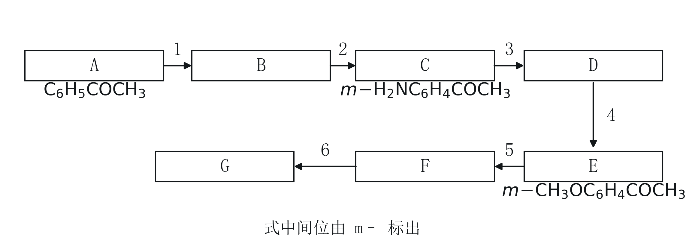
（1） B 的结构简式为①________________________________，D 的结构简式为②________________________________。
（2） 步骤 5 的反应类型为③________。F 分子有④________个手性碳原子。
（3） G 的分子式为⑤________。分子式与 F 相同的化合物中，若苯环上恰连一个甲氧基和一个含一个羟基的饱和二碳碳链，共有⑥________种（不考虑立体异构，计入 F 本身）。
（4） 用对羟基苯甲醛制备乙酸对甲氧基苄酯，依照题给信息写出三步合成路线，含中间体和试剂：⑦______________________________________________________________________________。
