# 2027年河南新高考模拟试卷　物理

满分100分，考试时间75分钟。

## 一、单项选择题

本大题共7小题，每小题4分，共28分。在每小题给出的四个选项中，只有一项是符合题目要求的。

## 1.（4分）

一台原子光谱仪只能探测能量不小于 \(2.0\,\mathrm{eV}\) 的光子。将一群原子激发到 \(-1.2\,\mathrm{eV}\) 的能级。可发生的向下跃迁只涉及 \(-2.4\,\mathrm{eV}\) 和 \(-5.4\,\mathrm{eV}\) 两个更低能级，各种途径均有原子经历。下列说法正确的是
A．仪器能探测到三条谱线
B．直接回到最低能级发出的光子波长最长
C．低于探测门槛的谱线对应 \(-2.4\,\mathrm{eV}\) 到 \(-5.4\,\mathrm{eV}\) 的跃迁
D．仪器所见的最长波长对应 \(3.0\,\mathrm{eV}\)

## 2.（4分）

检测设备的窗口由甲、乙两层透明材料组成，界面均平行，如图。甲层厚 \(3\sqrt3\,\mathrm{mm}\)、折射率为 \(\sqrt2\)，乙层厚 \(8.0\,\mathrm{mm}\)。一束光从空气以 \(45^\circ\) 入射，光从乙层射出的位置与入射点的水平距离为 \(7.0\,\mathrm{mm}\)。乙层折射率为
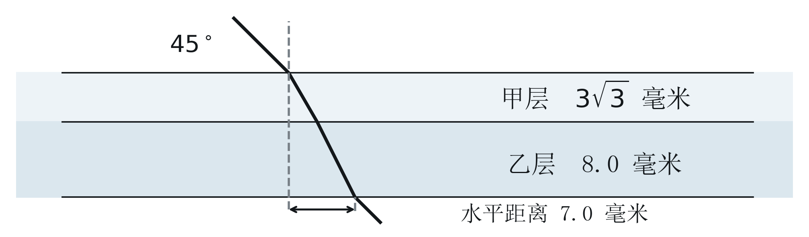
A．\(\sqrt{226}/14\)
B．\(\sqrt2\)
C．\(\sqrt{10}/2\)
D．\(\sqrt5\)

## 3.（4分）

天文台用凌星观测研究一颗恒星。行星沿周期为 \(T=12\,\mathrm{h}\) 的圆轨道运动，忽略行星半径，从地球看其投影沿恒星视圆盘的直径通过。如图，亮度下降持续 \(2.0\,\mathrm{h}\)。把恒星看成球体且行星质量远小于恒星质量，引力常量为 \(G\)。该恒星的平均密度为
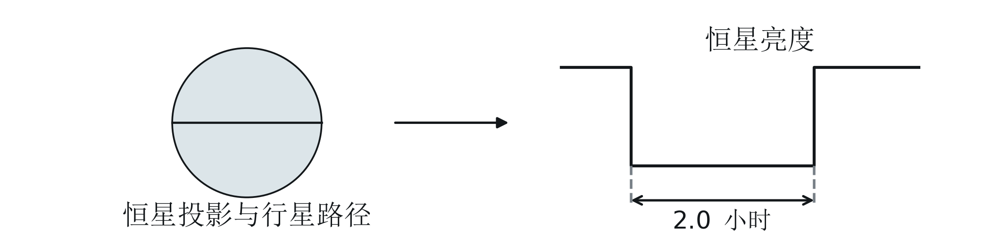
A．\(3\pi/(GT^2)\)
B．\(6\pi/(GT^2)\)
C．\(8\pi/(\sqrt3GT^2)\)
D．\(24\pi/(GT^2)\)

## 4.（4分）

在用电势传感器标定的一维静电场内，电势 \(\varphi\) 随位置 \(x\) 变化的折线如图。带电荷量 \(-q\) 的小球从原点由静止释放，\(q>0\)，只受静电力。在小球首次到达 \(2d\) 前，下列说法正确的是
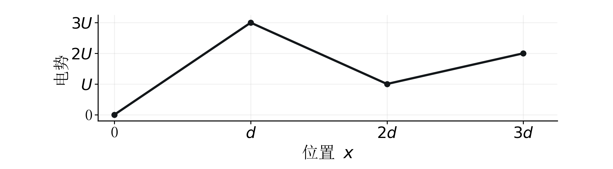
A．从原点到 \(d\)，电场方向沿 \(x\) 轴正向
B．在 \(d\) 处小球的电势能最大
C．从原点到 \(d\) 的时间大于从 \(d\) 到 \(2d\) 的时间
D．后段加速度的大小大于前段

## 5.（4分）

港口设备用一只闭合探测线圈辨认移动磁标。线圈为 \(4\) 匝，总电阻 \(6.0\,\Omega\)，自感忽略。如图，自 \(0\) 至 \(8.0\,\mathrm{ms}\) 每匝磁通量先增后减，初末都为零。下列说法正确的是
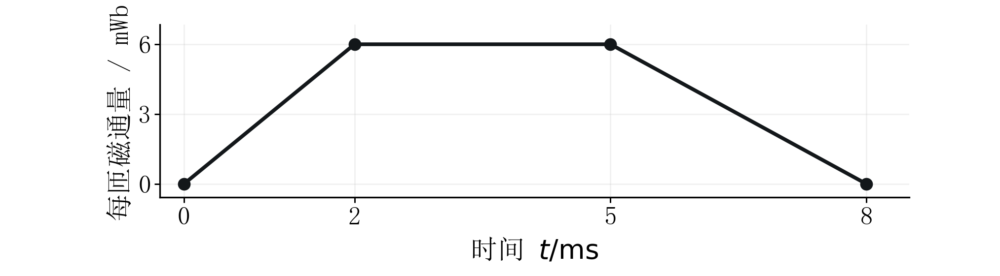
A．磁通量最大时感应电流最大
B．通过线圈导线截面的电荷量代数和为零
C．两个非零电流阶段产生的热量相等
D．第一个脉冲的电流大小为 \(0.50\,\mathrm{A}\)

## 6.（4分）

定量加料装置在竖直面内用轻绳悬挂边长为 \(L\) 的正方形线圈。图示上下水平边分别处在磁感应强度大小为 \(B\) 和 \(B/2\) 的两个匀强磁区，下区磁场垂直纸面，上区方向见图。两磁区左右对称，竖直边的水平磁力相互抵消。从不通电到按图示方向通电 \(I\)，绳仍绷紧，拉力减小 \(BIL/2\)。继而把下区磁场反向，同时把线圈电流反向并减为 \(I/2\)。下区原来的磁场方向和第二次调整后拉力相对通电 \(I\) 时的增加量分别为

A．向里，\(3BIL/4\)
B．向外，\(5BIL/4\)
C．向里，\(5BIL/4\)
D．向里，\(3BIL/2\)

## 7.（4分）

检修台有两条由若干直滑轨相接而成的下料通道。两通道的起点在同一高度，终点在同一高度。起点比终点高 \(1.5\,\mathrm{m}\)，从起点到终点的水平位移均为 \(4.0\,\mathrm{m}\)，各直段均在同一竖直面内向右下倾斜。连接处为无能量损失、长度可忽略的光滑短接头。两通道各直段的动摩擦因数均为 \(0.25\)，各段坡角的正切均大于 \(0.25\)，工件从静止释放并开始运动。取 \(g=9.80\,\mathrm{m/s^2}\)，忽略空气阻力。两通道末端工件的速率
A．都为 \(\sqrt{9.80}\,\mathrm{m/s}\)
B．都为 \(\sqrt{29.4}\,\mathrm{m/s}\)
C．直段总长较大的通道末速率较小
D．第一段较陡的通道末速率较大

## 二、多项选择题

本大题共3小题，每小题6分，共18分。在每小题给出的四个选项中，有多项符合题目要求。全部选对得满分，选对但不全得3分，有选错的得0分。

## 8.（6分）

甲、乙为两支同截面的气柱，分别密封同种、等物质的量的理想气体，初始压强、体积和温度分别均为 \(p_0,V_0,T_0\)。甲装在刚性管内，乙用可自由移动的活塞始终维持压强 \(p_0\)。固定在各气柱左端的探头发出弱声波，并记录从右端反射回探头的往返时间。加热前两者的往返时间均为 \(t_0\)。加热结束、各自稳定后的往返时间如图。气体中的声速与热力学温度的平方根成正比，忽略声波对气体的影响。下列说法正确的是
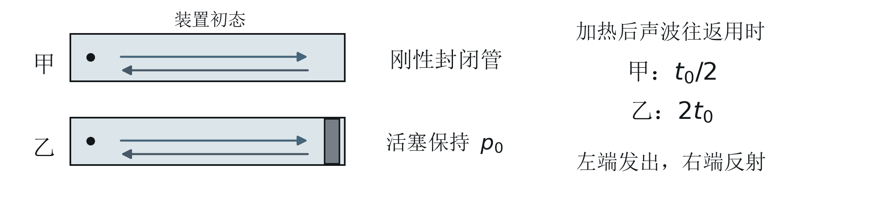
A．甲的末态温度高于乙
B．甲、乙两份气体的内能增量相同
C．乙比甲多吸收 \(3p_0V_0\) 的热量
D．若两探头发出频率相同的波，稳定后乙中波长是甲中的两倍

## 9.（6分）

离子分析装置将电荷量相同的正离子甲、乙分别从静止经同一恒定电压加速，并由 O 点水平向右射入图示的匀强磁场。两者在磁场中仅受洛伦兹力，分别运动半周后打在入射边界上。甲、乙击中点到 O 的距离分别为 \(2a\) 和 \(4a\)。下列说法正确的是
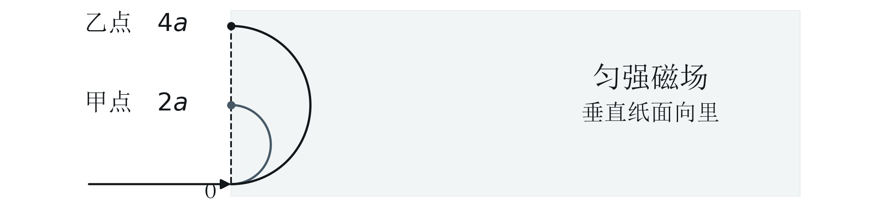
A．甲、乙进入磁场的速率比为 \(2:1\)
B．甲、乙在磁场中的运动时间比为 \(1:2\)
C．磁场不变，若分别调节两离子的加速电压使两击中点重合，则甲、乙的新电压之比为 \(4:1\)，两者的半周时间差不变
D．乙在磁场中圆周运动的加速度大小为甲的四分之一

## 10.（6分）

跳跃模块和两辆试验小车甲、乙的质量均为 \(m\)，小车可沿同一光滑水平直轨运动。开始三者均静止，模块在左车甲上，乙在甲右侧。模块从甲向乙起跳，离开甲瞬间相对甲的水平速度大小为 \(u\)，落在乙上后随乙运动。模块再向左起跳，离开乙瞬间相对乙的水平速度大小为 \(w\)。各次离合中水平外冲量可忽略，模块的空中运动不改变其水平速度；若满足水平追及条件，可控制竖直运动使模块落上甲车。以下判断正确的是
A．第一次起跳后甲的速率为 \(u/2\)
B．模块第一次落到乙上后共同速度为 \(u/2\)
C．模块第二次起跳后要重返甲车，须有 \(w>3u/2\)
D．若 \(w=2u\)，模块再次着车时乙车速率为 \(5u/4\)

## 三、非选择题

本大题共5小题，共54分。按题意填写或作答。计算题须写出必要的文字说明、方程式和演算步骤。

## 11.（6分）

实验小组用绳沿直导轨牵引装有加速度传感器的拖车。导轨倾角很小，图中未画出倾斜。拖车始终沿牵引方向运动，两个方向的滚动阻力大小相同且恒定。测力计读数 \(S\) 等于实际拉力与同一常量偏差之和，单独空载时读数为 \(0.04\,\mathrm N\)。分别向右、向左牵引，得到图中的读数—加速度关系。
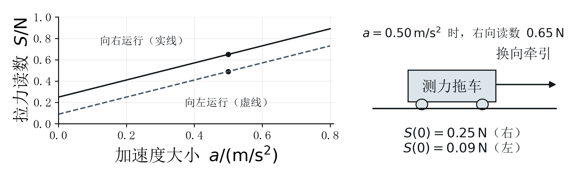
（1） 拖车质量为①________ kg。由图判断导轨较高的一端是②________端（填“左”或“右”）。
（2） 拖车所受滚动阻力为③________ N。若把测力计读数直接当作绳的拉力，算出的滚动阻力将④________（填“偏大”或“偏小”）。

## 12.（9分）

测量低值电阻 \(R\) 时，两根供电导线各有等值电阻 \(r\)，按图由 A、B 供电，C、D 是电阻本体两端。电压记录器的测量电流可忽略，换测各对端点时正输入端始终接左边。实际测值等于两点实际电势差加同一零位偏差。图中读数由改变供电电流方向取得，\(I>0\) 表示沿 A 到 B 的方向，导线和待测电阻均保持温度不变。
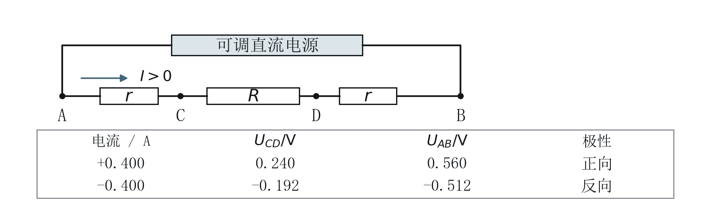
（1） 为直接测电阻 \(R\) 两端，应将电压记录器接在①________两点。记录器的零位偏差为②________ V（须写符号）。
（2） 由图计算，\(R=\)③________ Ω，每根供电导线的电阻 \(r=\)④________ Ω。
（3） 若仅将正向电流时的 \(U_{CD}\) 读数除以电流大小，测得的 \(R\) 将⑤________（填“偏大”或“偏小”）。说明理由：⑥______________________________________________________。

## 13.（10分）

固定光照下，小型光伏供电板的端电压 \(U\) 和输出电流 \(I\) 具有图示折线关系。折点为 \((4.0\,\mathrm{V},1.20\,\mathrm{A})\)，开路电压为 \(6.0\,\mathrm{V}\)。忽略导线电阻，连接的负载可视为纯电阻。
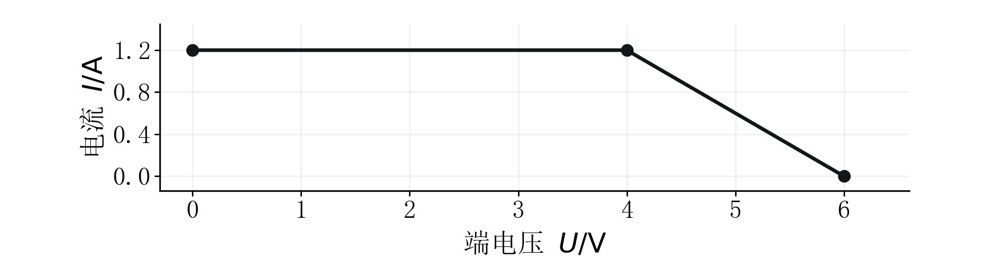
（1） 分别接入 \(2.50\,\Omega\) 和 \(25/3\,\Omega\) 的负载，求两个负载的稳态功率。
（2） 负载电阻可连续调节时，求供电板输出功率的最大值及此时的负载电阻。

## 14.（12分）

图示真空圆筒内半径为 \(L/2\)，磁感应强度大小为 \(B\) 的匀强磁场沿筒轴 \(+z\) 方向。筒口轴心位于 \(z=0\)，筒的另一端 \(z=2L\) 为接收板。质量为 \(m\)、带正电 \(q\) 的微粒从筒口轴心入射，初速度沿轴分量为 \(u\)（向 \(+z\)），垂直于轴的分量大小为 \(2u\)。接触筒壁或接收板即停止，不计重力及边缘场。只用磁场标定时，非接触观测到微粒入射后第一次回到轴线的位置为 \(z=L/2\)。
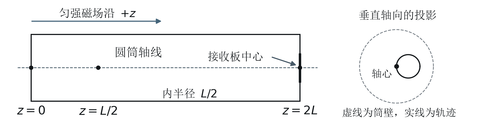
（1） 求磁感应强度 B，并判断微粒在只用磁场时会不会碰到圆筒侧壁。
（2） 保持 B 不变，另在整个筒内加沿筒轴的匀强电场，入射速度不变。为使微粒在第二次回到轴线时恰击中接收板中心，求电场的大小、方向及击中时微粒的速率。

## 15.（17分）

自动分拣台用水平传送带把质量 \(1.00\,\mathrm{kg}\) 的工件送上足够长的斜面，如图。带长 \(5.00\,\mathrm{m}\)，带面向右以 \(4.00\,\mathrm{m/s}\) 匀速运动，工件从左端由静止释放。工件与带、斜面间的动摩擦因数分别为 \(0.20\) 与 \(0.25\)，最大静摩擦力等于滑动摩擦力；斜角为 \(37^\circ\)。接头很短且光滑，换向时速率连续。沿斜面距接头 \(0.200\,\mathrm{m}\) 处设探头，工件每次通过发出一次信号。取 \(g=9.80\,\mathrm{m/s^2}\)，\(\sin37^\circ=0.60,\ \cos37^\circ=0.80\)。
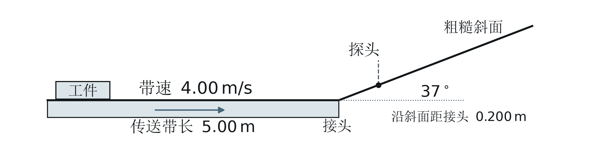
（1） 求工件首次进入斜面时的速率及该次在斜面上到达的最远距离。
（2） 探头共发出多少次信号？说明后续运动能否再次达到探头。
（3） 从释放工件到探头发出最后一次信号，求工件与传送带接触面上共产生的热量。
